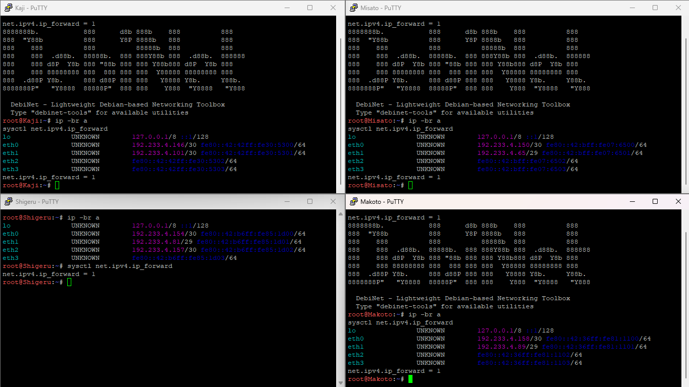
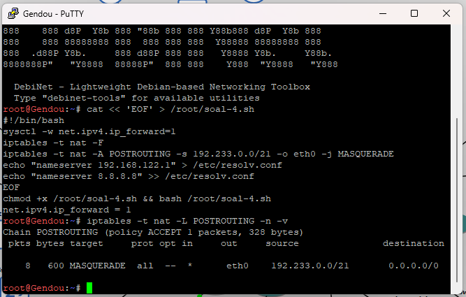
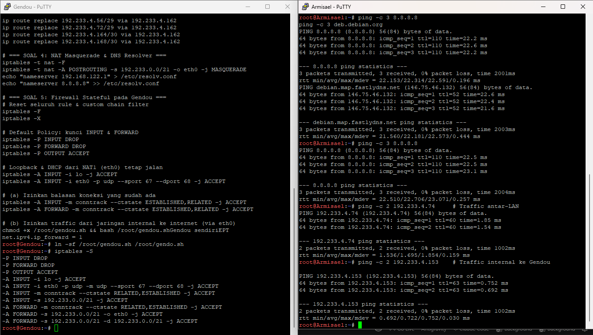
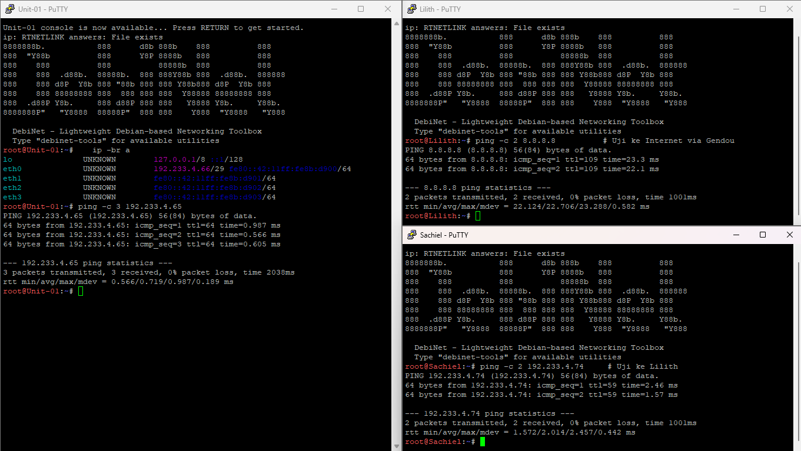
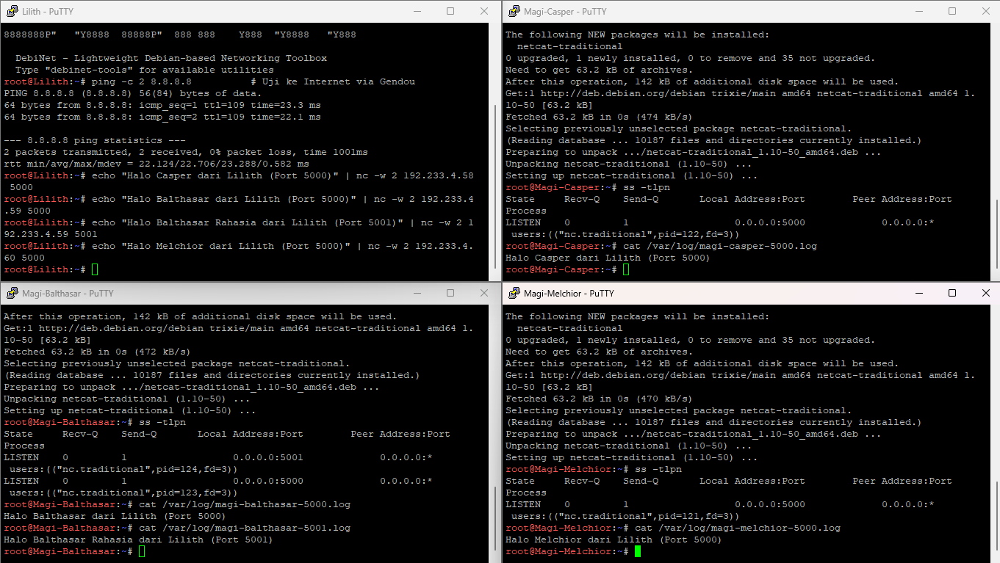
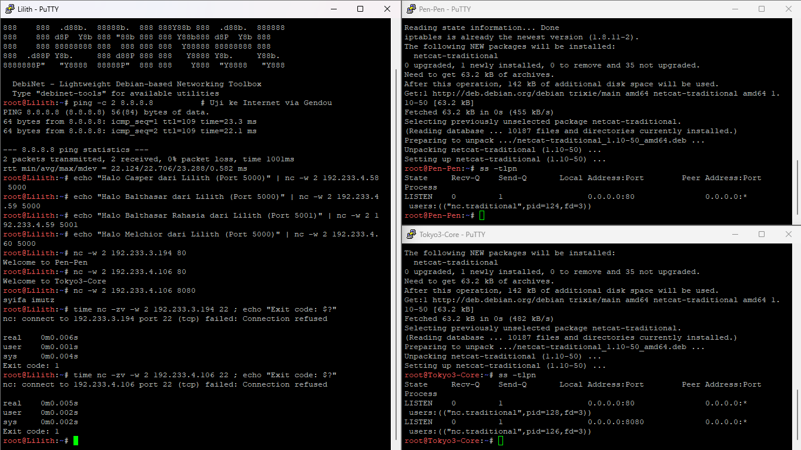

# Jarkom-Modul-5-2026-K-44

link sps: https://docs.google.com/spreadsheets/d/1-mP5GT1M9KDlxcKpBtNkRUqrD9dem_2P/edit?usp=sharing&ouid=107487448307781723146&rtpof=true&sd=true

## Nomor 1 — Perancangan Topologi & Pembagian IP VLSM

### Ringkasan Konfigurasi & Perancangan
Pada tahap Nomor 1, topologi jaringan **Modul 5 Komda K-44** dibangun di GNS3 dengan router inti **Gendou** (terhubung ke **NAT1** di `eth0`) beserta 16 router bawahan (**Yui**, **Mari**, **Rei**, **Shinji**, **Hikari**, **Kaworu**, **Asuka**, **Kensuke**, **Ritsuko**, **Kaji**, **Misato**, **Shigeru**, **Makoto**, **Fuyutsuki**, **Maya**, dan **Toji**), switch, serta node *end-host* pada blok alamat `192.233.0.0/21` (`A1`–`A33`). Pembagian subnet menggunakan skema **VLSM** sesuai kebutuhan host pada tiap rute.

### Tabel Alokasi Subnet VLSM (`A1`–`A33`)

| Subnet | Rute / Topologi | Network ID | Netmask | Range IP | Broadcast |
| :--- | :--- | :--- | :--- | :--- | :--- |
| `A1` | Gendou > Switch-Cmd > Tokyo3-Core | `192.233.4.104` | `255.255.255.252` | `192.233.4.105 - 192.233.4.106` | `192.233.4.107` |
| `A2` | Gendou > Yui | `192.233.4.108` | `255.255.255.252` | `192.233.4.109 - 192.233.4.110` | `192.233.4.111` |
| `A3` | Yui > Switch-Hangar > Hangar-Crew | `192.233.3.0` | `255.255.255.128` | `192.233.3.1 - 192.233.3.126` | `192.233.3.127` |
| `A4` | Yui > Mari | `192.233.4.112` | `255.255.255.252` | `192.233.4.113 - 192.233.4.114` | `192.233.4.115` |
| `A5` | Mari > Switch-Dock > Dock-Crew | `192.233.4.32` | `255.255.255.240` | `192.233.4.33 - 192.233.4.46` | `192.233.4.47` |
| `A6` | Yui > Rei | `192.233.4.116` | `255.255.255.252` | `192.233.4.117 - 192.233.4.118` | `192.233.4.119` |
| `A7` | Rei > Switch-Quarters > Quarters | `192.233.0.0` | `255.255.254.0` | `192.233.0.1 - 192.233.1.254` | `192.233.1.255` |
| `A8` | Yui > Shinji | `192.233.4.120` | `255.255.255.252` | `192.233.4.121 - 192.233.4.122` | `192.233.4.123` |
| `A9` | Shinji > Switch-Garden > Garden-Staff | `192.233.4.0` | `255.255.255.224` | `192.233.4.1 - 192.233.4.30` | `192.233.4.31` |
| `A10` | Gendou > Hikari | `192.233.4.124` | `255.255.255.252` | `192.233.4.125 - 192.233.4.126` | `192.233.4.127` |
| `A11` | Hikari > Switch-Comm > Comm-Net | `192.233.2.0` | `255.255.255.0` | `192.233.2.1 - 192.233.2.254` | `192.233.2.255` |
| `A12` | Hikari > Kaworu | `192.233.4.128` | `255.255.255.252` | `192.233.4.129 - 192.233.4.130` | `192.233.4.131` |
| `A13` | Kaworu > Switch-Relay > Relay-Node | `192.233.3.224` | `255.255.255.224` | `192.233.3.225 - 192.233.3.254` | `192.233.3.255` |
| `A14` | Gendou > Asuka | `192.233.4.132` | `255.255.255.252` | `192.233.4.133 - 192.233.4.134` | `192.233.4.135` |
| `A15` | Asuka > Switch-Archive > Archive-Vault | `192.233.4.96` | `255.255.255.252` | `192.233.4.97 - 192.233.4.98` | `192.233.4.99` |
| `A16` | Asuka > Kensuke | `192.233.4.136` | `255.255.255.252` | `192.233.4.137 - 192.233.4.138` | `192.233.4.139` |
| `A17` | Kensuke > Switch-Bunker > Sachiel | `192.233.3.128` | `255.255.255.192` | `192.233.3.129 - 192.233.3.190` | `192.233.3.191` |
| `A18` | Asuka > Ritsuko | `192.233.4.140` | `255.255.255.252` | `192.233.4.141 - 192.233.4.142` | `192.233.4.143` |
| `A19` | Ritsuko > Switch-Lab > Entry-Plug, Dummy-Plug | `192.233.4.48` | `255.255.255.248` | `192.233.4.49 - 192.233.4.54` | `192.233.4.55` |
| `A20` | Gendou > Kaji | `192.233.4.144` | `255.255.255.252` | `192.233.4.145 - 192.233.4.146` | `192.233.4.147` |
| `A21` | Kaji > Switch-Intel > Spy | `192.233.4.100` | `255.255.255.252` | `192.233.4.101 - 192.233.4.102` | `192.233.4.103` |
| `A22` | Gendou > Misato | `192.233.4.148` | `255.255.255.252` | `192.233.4.149 - 192.233.4.150` | `192.233.4.151` |
| `A23` | Misato > Switch-Cage > Unit-01, Unit-02, Unit-00 | `192.233.4.64` | `255.255.255.248` | `192.233.4.65 - 192.233.4.70` | `192.233.4.71` |
| `A24` | Gendou > Shigeru | `192.233.4.152` | `255.255.255.252` | `192.233.4.153 - 192.233.4.154` | `192.233.4.155` |
| `A25` | Shigeru > Switch-Monolith > Zeruel, Armisael | `192.233.4.80` | `255.255.255.248` | `192.233.4.81 - 192.233.4.86` | `192.233.4.87` |
| `A26` | Shigeru > Makoto | `192.233.4.156` | `255.255.255.252` | `192.233.4.157 - 192.233.4.158` | `192.233.4.159` |
| `A27` | Makoto > Switch-Radar > Radar-Array | `192.233.4.88` | `255.255.255.248` | `192.233.4.89 - 192.233.4.94` | `192.233.4.95` |
| `A28` | Gendou > Fuyutsuki | `192.233.4.160` | `255.255.255.252` | `192.233.4.161 - 192.233.4.162` | `192.233.4.163` |
| `A29` | Fuyutsuki > Switch-Terminal > Magi-Casper, Magi-Balthasar, Magi-Melchior | `192.233.4.56` | `255.255.255.248` | `192.233.4.57 - 192.233.4.62` | `192.233.4.63` |
| `A30` | Fuyutsuki > Maya | `192.233.4.164` | `255.255.255.252` | `192.233.4.165 - 192.233.4.166` | `192.233.4.167` |
| `A31` | Maya > Switch-Medic > Pen-Pen, Medic-Bay | `192.233.3.192` | `255.255.255.224` | `192.233.3.193 - 192.233.3.222` | `192.233.3.223` |
| `A32` | Fuyutsuki > Toji | `192.233.4.168` | `255.255.255.252` | `192.233.4.169 - 192.233.4.170` | `192.233.4.171` |
| `A33` | Toji > Switch-Dogma > Lilith, Adam | `192.233.4.72` | `255.255.255.248` | `192.233.4.73 - 192.233.4.78` | `192.233.4.79` |

### Verifikasi & Kendala
- Seluruh koneksi antar-router, switch, dan node telah dihubungkan sesuai gambar topologi (`topologi-modul-5.png`) dan tabel rute/VLSM (`K-44_Spreadsheet_Modul_5_Komda_Rute.csv` serta `K-44_Spreadsheet_Modul_5_Komda_Pembagian_IP_VLSM.csv`).
- Jika ada penyesuaian urutan port `ethX` pada node di GNS3, pemetaan alamat IP tetap mengacu pada tabel VLSM di atas.

## Nomor 2 — Konfigurasi Interface Router & IP Forwarding

### Ringkasan Konfigurasi
Pada tahap Nomor 2, seluruh 17 router (**Gendou**, **Yui**, **Mari**, **Rei**, **Shinji**, **Hikari**, **Kaworu**, **Asuka**, **Kensuke**, **Ritsuko**, **Kaji**, **Misato**, **Shigeru**, **Makoto**, **Fuyutsuki**, **Maya**, dan **Toji**) dipasang di GNS3 sesuai topologi[cite: 42]. Setiap router dikonfigurasi pada `/etc/network/interfaces` dengan detail berikut:
- **Gendou (`eth0`)** menggunakan `dhcp` untuk terhubung ke **NAT1**[cite: 42].
- Seluruh interface internal pada **Gendou (`eth1`–`eth8`)** serta 16 router lainnya diberi alamat IP `static` berdasarkan pembagian VLSM pada Nomor 1[cite: 41, 42].
- Fitur **IP Forwarding** diaktifkan secara otomatis saat interface naik melalui perintah `up sysctl -w net.ipv4.ip_forward=1`[cite: 42].

### Konfigurasi `/etc/network/interfaces` Tiap Router

#### 1. Gendou
```text
auto lo
iface lo inet loopback

auto eth0
iface eth0 inet dhcp
    up sysctl -w net.ipv4.ip_forward=1

auto eth1
iface eth1 inet static
    address 192.233.4.105
    netmask 255.255.255.252

auto eth2
iface eth2 inet static
    address 192.233.4.109
    netmask 255.255.255.252

auto eth3
iface eth3 inet static
    address 192.233.4.125
    netmask 255.255.255.252

auto eth4
iface eth4 inet static
    address 192.233.4.133
    netmask 255.255.255.252

auto eth5
iface eth5 inet static
    address 192.233.4.145
    netmask 255.255.255.252

auto eth6
iface eth6 inet static
    address 192.233.4.149
    netmask 255.255.255.252

auto eth7
iface eth7 inet static
    address 192.233.4.153
    netmask 255.255.255.252

auto eth8
iface eth8 inet static
    address 192.233.4.161
    netmask 255.255.255.252

```

#### 2. Cabang Yui (Yui, Mari, Rei, Shinji)

* **Yui**

```text
auto lo
iface lo inet loopback

auto eth0
iface eth0 inet static
    address 192.233.4.110
    netmask 255.255.255.252
    up sysctl -w net.ipv4.ip_forward=1

auto eth1
iface eth1 inet static
    address 192.233.3.1
    netmask 255.255.255.128

auto eth2
iface eth2 inet static
    address 192.233.4.113
    netmask 255.255.255.252

auto eth3
iface eth3 inet static
    address 192.233.4.117
    netmask 255.255.255.252

auto eth4
iface eth4 inet static
    address 192.233.4.121
    netmask 255.255.255.252

```

* **Mari**

```text
auto lo
iface lo inet loopback

auto eth0
iface eth0 inet static
    address 192.233.4.114
    netmask 255.255.255.252
    up sysctl -w net.ipv4.ip_forward=1

auto eth1
iface eth1 inet static
    address 192.233.4.33
    netmask 255.255.255.240

```

* **Rei**

```text
auto lo
iface lo inet loopback

auto eth0
iface eth0 inet static
    address 192.233.4.118
    netmask 255.255.255.252
    up sysctl -w net.ipv4.ip_forward=1

auto eth1
iface eth1 inet static
    address 192.233.0.1
    netmask 255.255.254.0

```

* **Shinji**

```text
auto lo
iface lo inet loopback

auto eth0
iface eth0 inet static
    address 192.233.4.122
    netmask 255.255.255.252
    up sysctl -w net.ipv4.ip_forward=1

auto eth1
iface eth1 inet static
    address 192.233.4.1
    netmask 255.255.255.224

```

#### 3. Cabang Hikari (Hikari, Kaworu)

* **Hikari**

```text
auto lo
iface lo inet loopback

auto eth0
iface eth0 inet static
    address 192.233.4.126
    netmask 255.255.255.252
    up sysctl -w net.ipv4.ip_forward=1

auto eth1
iface eth1 inet static
    address 192.233.2.1
    netmask 255.255.255.0

auto eth2
iface eth2 inet static
    address 192.233.4.129
    netmask 255.255.255.252

```

* **Kaworu**

```text
auto lo
iface lo inet loopback

auto eth0
iface eth0 inet static
    address 192.233.4.130
    netmask 255.255.255.252
    up sysctl -w net.ipv4.ip_forward=1

auto eth1
iface eth1 inet static
    address 192.233.3.225
    netmask 255.255.255.224

```

#### 4. Cabang Asuka (Asuka, Kensuke, Ritsuko)

* **Asuka**

```text
auto lo
iface lo inet loopback

auto eth0
iface eth0 inet static
    address 192.233.4.134
    netmask 255.255.255.252
    up sysctl -w net.ipv4.ip_forward=1

auto eth1
iface eth1 inet static
    address 192.233.4.97
    netmask 255.255.255.252

auto eth2
iface eth2 inet static
    address 192.233.4.137
    netmask 255.255.255.252

auto eth3
iface eth3 inet static
    address 192.233.4.141
    netmask 255.255.255.252

```

* **Kensuke**

```text
auto lo
iface lo inet loopback

auto eth0
iface eth0 inet static
    address 192.233.4.138
    netmask 255.255.255.252
    up sysctl -w net.ipv4.ip_forward=1

auto eth1
iface eth1 inet static
    address 192.233.3.129
    netmask 255.255.255.192

```

* **Ritsuko**

```text
auto lo
iface lo inet loopback

auto eth0
iface eth0 inet static
    address 192.233.4.142
    netmask 255.255.255.252
    up sysctl -w net.ipv4.ip_forward=1

auto eth1
iface eth1 inet static
    address 192.233.4.49
    netmask 255.255.255.248

```

#### 5. Cabang Kaji, Misato, & Shigeru (Kaji, Misato, Shigeru, Makoto)

* **Kaji**

```text
auto lo
iface lo inet loopback

auto eth0
iface eth0 inet static
    address 192.233.4.146
    netmask 255.255.255.252
    up sysctl -w net.ipv4.ip_forward=1

auto eth1
iface eth1 inet static
    address 192.233.4.101
    netmask 255.255.255.252

```

* **Misato**

```text
auto lo
iface lo inet loopback

auto eth0
iface eth0 inet static
    address 192.233.4.150
    netmask 255.255.255.252
    up sysctl -w net.ipv4.ip_forward=1

auto eth1
iface eth1 inet static
    address 192.233.4.65
    netmask 255.255.255.248

```

* **Shigeru**

```text
auto lo
iface lo inet loopback

auto eth0
iface eth0 inet static
    address 192.233.4.154
    netmask 255.255.255.252
    up sysctl -w net.ipv4.ip_forward=1

auto eth1
iface eth1 inet static
    address 192.233.4.81
    netmask 255.255.255.248

auto eth2
iface eth2 inet static
    address 192.233.4.157
    netmask 255.255.255.252

```

* **Makoto**

```text
auto lo
iface lo inet loopback

auto eth0
iface eth0 inet static
    address 192.233.4.158
    netmask 255.255.255.252
    up sysctl -w net.ipv4.ip_forward=1

auto eth1
iface eth1 inet static
    address 192.233.4.89
    netmask 255.255.255.248

```

#### 6. Cabang Fuyutsuki (Fuyutsuki, Maya, Toji)

* **Fuyutsuki**

```text
auto lo
iface lo inet loopback

auto eth0
iface eth0 inet static
    address 192.233.4.162
    netmask 255.255.255.252
    up sysctl -w net.ipv4.ip_forward=1

auto eth1
iface eth1 inet static
    address 192.233.4.57
    netmask 255.255.255.248

auto eth2
iface eth2 inet static
    address 192.233.4.165
    netmask 255.255.255.252

auto eth3
iface eth3 inet static
    address 192.233.4.169
    netmask 255.255.255.252

```

* **Maya**

```text
auto lo
iface lo inet loopback

auto eth0
iface eth0 inet static
    address 192.233.4.166
    netmask 255.255.255.252
    up sysctl -w net.ipv4.ip_forward=1

auto eth1
iface eth1 inet static
    address 192.233.3.193
    netmask 255.255.255.224

```

* **Toji**

```text
auto lo
iface lo inet loopback

auto eth0
iface eth0 inet static
    address 192.233.4.170
    netmask 255.255.255.252
    up sysctl -w net.ipv4.ip_forward=1

auto eth1
iface eth1 inet static
    address 192.233.4.73
    netmask 255.255.255.248

```

### Pengujian & Verifikasi

1. **Pengecekan Status Interface & IP Forwarding di Tiap Router**
Jalankan perintah berikut pada terminal masing-masing dari 17 router untuk memastikan seluruh interface berstatus `UP`, memiliki IP sesuai tabel VLSM, dan `ip_forward` bernilai `1`:
```bash
ip -br a
sysctl net.ipv4.ip_forward

```


2. **Pengujian Konektivitas Point-to-Point Antar-Link Router (16 Link)**
Lakukan `ping` antara dua ujung interface yang terhubung langsung dalam satu subnet `/30`:

| Link | Router Asal | Interface & IP Asal | Router Tujuan | Interface & IP Tujuan | Perintah Uji (`ping`) |
| --- | --- | --- | --- | --- | --- |
| `A2` | Gendou | `eth2` (`192.233.4.109`) | Yui | `eth0` (`192.233.4.110`) | `ping -c 3 192.233.4.110` |
| `A4` | Yui | `eth2` (`192.233.4.113`) | Mari | `eth0` (`192.233.4.114`) | `ping -c 3 192.233.4.114` |
| `A6` | Yui | `eth3` (`192.233.4.117`) | Rei | `eth0` (`192.233.4.118`) | `ping -c 3 192.233.4.118` |
| `A8` | Yui | `eth4` (`192.233.4.121`) | Shinji | `eth0` (`192.233.4.122`) | `ping -c 3 192.233.4.122` |
| `A10` | Gendou | `eth3` (`192.233.4.125`) | Hikari | `eth0` (`192.233.4.126`) | `ping -c 3 192.233.4.126` |
| `A12` | Hikari | `eth2` (`192.233.4.129`) | Kaworu | `eth0` (`192.233.4.130`) | `ping -c 3 192.233.4.130` |
| `A14` | Gendou | `eth4` (`192.233.4.133`) | Asuka | `eth0` (`192.233.4.134`) | `ping -c 3 192.233.4.134` |
| `A16` | Asuka | `eth2` (`192.233.4.137`) | Kensuke | `eth0` (`192.233.4.138`) | `ping -c 3 192.233.4.138` |
| `A18` | Asuka | `eth3` (`192.233.4.141`) | Ritsuko | `eth0` (`192.233.4.142`) | `ping -c 3 192.233.4.142` |
| `A20` | Gendou | `eth5` (`192.233.4.145`) | Kaji | `eth0` (`192.233.4.146`) | `ping -c 3 192.233.4.146` |
| `A22` | Gendou | `eth6` (`192.233.4.149`) | Misato | `eth0` (`192.233.4.150`) | `ping -c 3 192.233.4.150` |
| `A24` | Gendou | `eth7` (`192.233.4.153`) | Shigeru | `eth0` (`192.233.4.154`) | `ping -c 3 192.233.4.154` |
| `A26` | Shigeru | `eth2` (`192.233.4.157`) | Makoto | `eth0` (`192.233.4.158`) | `ping -c 3 192.233.4.158` |
| `A28` | Gendou | `eth8` (`192.233.4.161`) | Fuyutsuki | `eth0` (`192.233.4.162`) | `ping -c 3 192.233.4.162` |
| `A30` | Fuyutsuki | `eth2` (`192.233.4.165`) | Maya | `eth0` (`192.233.4.166`) | `ping -c 3 192.233.4.166` |
| `A32` | Fuyutsuki | `eth3` (`192.233.4.169`) | Toji | `eth0` (`192.233.4.170`) | `ping -c 3 192.233.4.170` |


3. **Bukti Screenshot**
* Output `ip -br a` dan `sysctl net.ipv4.ip_forward`

Gendou,Yui, Mari, Rei


Shinji, Hikari, Kaworu, Asuka


Kaji, Misato, Shigeru, Makoto




Fuyutsuki, Maya, Toji


* Ping Point-to-Point


Dari Gendou ke Yui, Hikari, Asuka, Kaji, Misato, Shigeru, Fuyutsuki


Dari Yui ke Mari, Rei, Shinji


Dari Hikari ke Kaworu


Dari Asuka ke Kensuke dan Ritsuko


Dari Shigeru ke Makoto


Dari Fuyutsuki ke Maya dan Toji


---

## Nomor 3 — Static Routing & CIDR Summarization

### Ringkasan Konfigurasi
Pada tahap Nomor 3, seluruh segmen jaringan yang terpisah dihubungkan menggunakan **static routing** dengan jumlah rute seminimal mungkin:
- **Gendou** mempertahankan *default route* otomatis dari `eth0` (DHCP menuju **NAT1**) dan memiliki rute statis ke setiap cabang di bawahnya.
- Subnet satu cabang yang bersebelahan dan dapat digabung tepat menjadi satu blok CIDR diringkas (*route summarization*):
  - **Cabang Yui:** `A4` (`192.233.4.112/30`) + `A6` (`192.233.4.116/30`) $\rightarrow$ `192.233.4.112/29`
  - **Cabang Asuka:** `A16` (`192.233.4.136/30`) + `A18` (`192.233.4.140/30`) $\rightarrow$ `192.233.4.136/29`
  - **Cabang Shigeru:** `A25` (`192.233.4.80/29`) + `A27` (`192.233.4.88/29`) $\rightarrow$ `192.233.4.80/28`
- **16 router lainnya** cukup memiliki **1 default route ke atas** serta rute statis ke subnet di bawahnya (khusus router ujung/*leaf* hanya memiliki 1 *default route* ke atas).
- Konfigurasi rute disimpan di `/root/soal-3.sh` pada tiap router dan dipanggil otomatis saat boot melalui `up bash /root/soal-3.sh` di `/etc/network/interfaces`.
- Untuk kebutuhan pengujian Nomor 3 hingga Nomor 5, 4 node uji (**Armisael**, **Lilith**, **Sachiel**, dan **Comm-Net**) diberi IP dan *default gateway* sementara.

### Tabel Rute Statis & CIDR Summarization

| Router | Tujuan Network / CIDR | Next-Hop (`via`) | Keterangan |
| :--- | :--- | :--- | :--- |
| **Gendou** | `192.233.0.0/23`, `192.233.3.0/25`, `192.233.4.0/27`, `192.233.4.32/28`, `192.233.4.112/29`, `192.233.4.120/30` | `192.233.4.110` | Cabang Yui (`A4`+`A6` diringkas ke `/29`) |
| **Gendou** | `192.233.2.0/24`, `192.233.3.224/27`, `192.233.4.128/30` | `192.233.4.126` | Cabang Hikari |
| **Gendou** | `192.233.3.128/26`, `192.233.4.48/29`, `192.233.4.96/30`, `192.233.4.136/29` | `192.233.4.134` | Cabang Asuka (`A16`+`A18` diringkas ke `/29`) |
| **Gendou** | `192.233.4.100/30` | `192.233.4.146` | Cabang Kaji |
| **Gendou** | `192.233.4.64/29` | `192.233.4.150` | Cabang Misato |
| **Gendou** | `192.233.4.80/28`, `192.233.4.156/30` | `192.233.4.154` | Cabang Shigeru (`A25`+`A27` diringkas ke `/28`) |
| **Gendou** | `192.233.3.192/27`, `192.233.4.56/29`, `192.233.4.72/29`, `192.233.4.164/30`, `192.233.4.168/30` | `192.233.4.162` | Cabang Fuyutsuki |
| **Yui** | `default` / `192.233.4.32/28` / `192.233.0.0/23` / `192.233.4.0/27` | `.109` / `.114` / `.118` / `.122` | Atas (Gendou) & bawah (Mari, Rei, Shinji) |
| **Hikari** | `default` / `192.233.3.224/27` | `.125` / `.130` | Atas (Gendou) & bawah (Kaworu) |
| **Asuka** | `default` / `192.233.3.128/26` / `192.233.4.48/29` | `.133` / `.138` / `.142` | Atas (Gendou) & bawah (Kensuke, Ritsuko) |
| **Shigeru** | `default` / `192.233.4.88/29` | `.153` / `.158` | Atas (Gendou) & bawah (Makoto) |
| **Fuyutsuki** | `default` / `192.233.3.192/27` / `192.233.4.72/29` | `.161` / `.166` / `.170` | Atas (Gendou) & bawah (Maya, Toji) |
| **Router Leaf** | `default` | IP ujung atas masing-masing | Mari, Rei, Shinji, Kaworu, Kensuke, Ritsuko, Kaji, Misato, Makoto, Maya, Toji |

### Pengalamatan Sementara 4 Node Uji (Soal 3–5)

| Node Uji | Subnet | IP Sementara | Gateway |
| :--- | :--- | :--- | :--- |
| **Armisael** | `A25` (`192.233.4.80/29`) | `192.233.4.83/29` | `192.233.4.81` |
| **Lilith** | `A33` (`192.233.4.72/29`) | `192.233.4.74/29` | `192.233.4.73` |
| **Sachiel** | `A17` (`192.233.3.128/26`) | `192.233.3.130/26` | `192.233.3.129` |
| **Comm-Net** | `A11` (`192.233.2.0/24`) | `192.233.2.2/24` | `192.233.2.1` |

### Skrip Konfigurasi (`/root/soal-3.sh`)

#### 1. Gendou
```bash
#!/bin/bash
# Cabang Yui (A4 + A6 diringkas ke 192.233.4.112/29)
ip route replace 192.233.0.0/23 via 192.233.4.110
ip route replace 192.233.3.0/25 via 192.233.4.110
ip route replace 192.233.4.0/27 via 192.233.4.110
ip route replace 192.233.4.32/28 via 192.233.4.110
ip route replace 192.233.4.112/29 via 192.233.4.110
ip route replace 192.233.4.120/30 via 192.233.4.110

# Cabang Hikari
ip route replace 192.233.2.0/24 via 192.233.4.126
ip route replace 192.233.3.224/27 via 192.233.4.126
ip route replace 192.233.4.128/30 via 192.233.4.126

# Cabang Asuka (A16 + A18 diringkas ke 192.233.4.136/29)
ip route replace 192.233.3.128/26 via 192.233.4.134
ip route replace 192.233.4.48/29 via 192.233.4.134
ip route replace 192.233.4.96/30 via 192.233.4.134
ip route replace 192.233.4.136/29 via 192.233.4.134

# Cabang Kaji & Misato
ip route replace 192.233.4.100/30 via 192.233.4.146
ip route replace 192.233.4.64/29 via 192.233.4.150

# Cabang Shigeru (A25 + A27 diringkas ke 192.233.4.80/28)
ip route replace 192.233.4.80/28 via 192.233.4.154
ip route replace 192.233.4.156/30 via 192.233.4.154

# Cabang Fuyutsuki
ip route replace 192.233.3.192/27 via 192.233.4.162
ip route replace 192.233.4.56/29 via 192.233.4.162
ip route replace 192.233.4.72/29 via 192.233.4.162
ip route replace 192.233.4.164/30 via 192.233.4.162
ip route replace 192.233.4.168/30 via 192.233.4.162

```

#### 2. Router Tengah (Yui, Hikari, Asuka, Shigeru, Fuyutsuki)

* **Yui**

```bash
#!/bin/bash
ip route replace default via 192.233.4.109
ip route replace 192.233.4.32/28 via 192.233.4.114
ip route replace 192.233.0.0/23 via 192.233.4.118
ip route replace 192.233.4.0/27 via 192.233.4.122

```

* **Hikari**

```bash
#!/bin/bash
ip route replace default via 192.233.4.125
ip route replace 192.233.3.224/27 via 192.233.4.130

```

* **Asuka**

```bash
#!/bin/bash
ip route replace default via 192.233.4.133
ip route replace 192.233.3.128/26 via 192.233.4.138
ip route replace 192.233.4.48/29 via 192.233.4.142

```

* **Shigeru**

```bash
#!/bin/bash
ip route replace default via 192.233.4.153
ip route replace 192.233.4.88/29 via 192.233.4.158

```

* **Fuyutsuki**

```bash
#!/bin/bash
ip route replace default via 192.233.4.161
ip route replace 192.233.3.192/27 via 192.233.4.166
ip route replace 192.233.4.72/29 via 192.233.4.170

```

#### 3. Router Leaf

```bash
# Mari      : ip route replace default via 192.233.4.113
# Rei       : ip route replace default via 192.233.4.117
# Shinji    : ip route replace default via 192.233.4.121
# Kaworu    : ip route replace default via 192.233.4.129
# Kensuke   : ip route replace default via 192.233.4.137
# Ritsuko   : ip route replace default via 192.233.4.141
# Kaji      : ip route replace default via 192.233.4.145
# Misato    : ip route replace default via 192.233.4.149
# Makoto    : ip route replace default via 192.233.4.157
# Maya      : ip route replace default via 192.233.4.165
# Toji      : ip route replace default via 192.233.4.169

```

### Pengujian & Verifikasi

1. **Pengecekan Tabel Routing di Router Utama & Cabang**
Jalankan `ip route` pada **Gendou**, **Yui**, **Hikari**, **Asuka**, **Shigeru**, dan **Fuyutsuki** untuk memverifikasi bahwa rute statis dan rute hasil *CIDR summarization* (`/29` dan `/28`) sudah terpasang dengan benar:
```bash
ip route

```


2. **Pengujian Konektivitas Antar-LAN dari Armisael**
Dari terminal **Armisael** (`192.233.4.83`), lakukan `ping` menuju **Lilith**, **Sachiel**, dan **Comm-Net**:
```bash
ping -c 3 192.233.4.74     # Armisael -> Lilith
ping -c 3 192.233.3.130    # Armisael -> Sachiel
ping -c 3 192.233.2.2      # Armisael -> Comm-Net

```


3. **Bukti Screenshot**
* Output `ip route` pada semua router

Gendou, Yui, Mari


Rei, Shinji, Hikari, Kaworu


Asuka, Kensuke, Ritsuko, Kaji


Misato, Shigeru, Makoto, Fuyutsuki


Maya dan Toji


* Hasil `ping` dari Armisael ke Lilith, Sachiel, dan Comm-Net dengan status `0% packet loss`


---

## Nomor 4 — Akses Internet (NAT Masquerade) & DNS Resolver

### Ringkasan Konfigurasi
Pada tahap Nomor 4, seluruh jaringan internal (`192.233.0.0/21`) diberikan akses internet melalui router gerbang **Gendou** (`eth0` menuju **NAT1**) sebelum pemasangan paket dilakukan pada node lainnya. Konfigurasi diterapkan dengan ketentuan sebagai berikut:
- Menggunakan target **`MASQUERADE`** pada rantai `POSTROUTING` tabel `nat` agar translasi alamat IP menyesuaikan secara otomatis apabila alamat IP DHCP pada interface `eth0` (dari **NAT1**) berubah.
- Membatasi translasi alamat hanya untuk lalu lintas yang berasal dari blok prefix internal `-s 192.233.0.0/21` dan keluar melalui interface WAN `-o eth0`. Dengan demikian, komunikasi antar-LAN internal tidak terkena NAT dan tetap membawa alamat IP asli pengirim.
- Menambahkan konfigurasi DNS resolver (`192.168.122.1` dan `8.8.8.8`) pada `/etc/resolv.conf` agar seluruh node mampu melakukan resolusi nama domain (*domain name resolution*).
- Skrip disimpan pada `/root/soal-4.sh` di router **Gendou** dan dipanggil otomatis saat interface `eth0` aktif melalui perintah `up bash /root/soal-4.sh` di `/etc/network/interfaces`.

### Konfigurasi Interface & Skrip

#### 1. Konfigurasi `/etc/network/interfaces` pada Gendou (`eth0`)
```text
auto eth0
iface eth0 inet dhcp
    up sysctl -w net.ipv4.ip_forward=1
    up bash /root/soal-4.sh
```

#### 2. Skrip `/root/soal-4.sh` pada Gendou
```bash
#!/bin/bash
sysctl -w net.ipv4.ip_forward=1
iptables -t nat -F
iptables -t nat -A POSTROUTING -s 192.233.0.0/21 -o eth0 -j MASQUERADE
echo "nameserver 192.168.122.1" > /etc/resolv.conf
echo "nameserver 8.8.8.8" >> /etc/resolv.conf
```

#### 3. Konfigurasi DNS Resolver (`/etc/resolv.conf`) pada Node Uji
```text
nameserver 192.168.122.1
nameserver 8.8.8.8
```

### Pengujian & Verifikasi

1. **Pengujian Koneksi Internet & Resolusi Nama Domain dari Armisael dan Lilith**
   Jalankan perintah `ping` ke IP publik (`8.8.8.8`) dan domain (`deb.debian.org`) dari terminal **Armisael** (`192.233.4.83`) dan **Lilith** (`192.233.4.74`) untuk memastikan koneksi keluar melalui NAT serta DNS resolver berfungsi:
   ```bash
   ping -c 3 8.8.8.8
   ping -c 3 deb.debian.org
   ```

2. **Verifikasi Counter Rule NAT pada Gendou**
   Jalankan perintah berikut pada terminal **Gendou** untuk memastikan aturan `MASQUERADE` aktif dengan source `192.233.0.0/21`, out-interface `eth0`, serta memastikan nilai kolom `pkts` dan `bytes` bertambah setelah pengujian `ping`:
   ```bash
   iptables -t nat -L POSTROUTING -n -v
   ```

3. **Bukti Screenshot**
   - Hasil `ping 8.8.8.8` dan `ping deb.debian.org` dari terminal **Armisael** dan **Lilith** dengan status `0% packet loss`


   - Output `iptables -t nat -L POSTROUTING -n -v` pada **Gendou** yang memperlihatkan rule `MASQUERADE` dan counter paket/byte yang bertambah



---

## Nomor 5 — Firewall Stateful pada Gerbang Gendou (`/root/gendou.sh`)

### Ringkasan Konfigurasi
Pada tahap Nomor 5, router gerbang **Gendou** diamankan menggunakan **stateful firewall** (`iptables`) untuk mengunci koneksi baru dari arah luar (**NAT1** / `eth0`) sekaligus memastikan seluruh konfigurasi pada **Nomor 2** (*IP forwarding*), **Nomor 3** (*static routing* & *CIDR summarization*), dan **Nomor 4** (*NAT masquerade* & *DNS resolver*) terpusat di dalam skrip `/root/gendou.sh` (serta *symlink* `/root/gendo.sh`).

Kebijakan dan aturan firewall yang diterapkan pada **Gendou**:
- **Default Policy:** Mengubah kebijakan default `INPUT` dan `FORWARD` menjadi **`DROP`**, sedangkan `OUTPUT` tetap **`ACCEPT`** sehingga koneksi baru yang masuk dari sisi **NAT1** (`eth0`) otomatis diblokir.
- **Loopback & DHCP Client:** Mengizinkan lalu lintas interface loopback (`-i lo`) dan paket balasan/pembaruan sewa DHCP dari server **NAT1** pada `eth0` (UDP port `67` $\rightarrow$ `68`).
- **Empat Akses yang Diizinkan:**
  - **(a) Balasan koneksi yang sudah ada:** Mengizinkan state `ESTABLISHED,RELATED` pada rantai `INPUT` dan `FORWARD`.
  - **(b) Traffic dari jaringan internal ke internet:** Mengizinkan paket dari blok internal `-s 192.233.0.0/21` yang keluar menuju `-o eth0` pada rantai `FORWARD`.
  - **(c) Traffic antar-LAN:** Mengizinkan lalu lintas dari `-s 192.233.0.0/21` menuju `-d 192.233.0.0/21` pada rantai `FORWARD`.
  - **(d) Traffic dari jaringan internal ke Gendou sendiri:** Mengizinkan akses dari `-s 192.233.0.0/21` pada rantai `INPUT`.

### Konfigurasi Interface & Skrip

#### 1. Konfigurasi `/etc/network/interfaces` pada Gendou (`eth8`)
```text
auto eth8
iface eth8 inet static
    address 192.233.4.161
    netmask 255.255.255.252
    up bash /root/gendou.sh
```

#### 2. Skrip Gabungan `/root/gendou.sh` (Soal 2 – Soal 5)
```bash
#!/bin/bash

# === SOAL 2: IP Forwarding ===
sysctl -w net.ipv4.ip_forward=1

# === SOAL 3: Static Routing & CIDR Summarization ===
# Cabang Yui (A4 + A6 diringkas ke 192.233.4.112/29)
ip route replace 192.233.0.0/23 via 192.233.4.110
ip route replace 192.233.3.0/25 via 192.233.4.110
ip route replace 192.233.4.0/27 via 192.233.4.110
ip route replace 192.233.4.32/28 via 192.233.4.110
ip route replace 192.233.4.112/29 via 192.233.4.110
ip route replace 192.233.4.120/30 via 192.233.4.110

# Cabang Hikari
ip route replace 192.233.2.0/24 via 192.233.4.126
ip route replace 192.233.3.224/27 via 192.233.4.126
ip route replace 192.233.4.128/30 via 192.233.4.126

# Cabang Asuka (A16 + A18 diringkas ke 192.233.4.136/29)
ip route replace 192.233.3.128/26 via 192.233.4.134
ip route replace 192.233.4.48/29 via 192.233.4.134
ip route replace 192.233.4.96/30 via 192.233.4.134
ip route replace 192.233.4.136/29 via 192.233.4.134

# Cabang Kaji & Misato
ip route replace 192.233.4.100/30 via 192.233.4.146
ip route replace 192.233.4.64/29 via 192.233.4.150

# Cabang Shigeru (A25 + A27 diringkas ke 192.233.4.80/28)
ip route replace 192.233.4.80/28 via 192.233.4.154
ip route replace 192.233.4.156/30 via 192.233.4.154

# Cabang Fuyutsuki
ip route replace 192.233.3.192/27 via 192.233.4.162
ip route replace 192.233.4.56/29 via 192.233.4.162
ip route replace 192.233.4.72/29 via 192.233.4.162
ip route replace 192.233.4.164/30 via 192.233.4.162
ip route replace 192.233.4.168/30 via 192.233.4.162

# === SOAL 4: NAT Masquerade & DNS Resolver ===
iptables -t nat -F
iptables -t nat -A POSTROUTING -s 192.233.0.0/21 -o eth0 -j MASQUERADE
echo "nameserver 192.168.122.1" > /etc/resolv.conf
echo "nameserver 8.8.8.8" >> /etc/resolv.conf

# === SOAL 5: Firewall Stateful pada Gendou ===
iptables -F
iptables -X

# Default Policy: kunci INPUT & FORWARD
iptables -P INPUT DROP
iptables -P FORWARD DROP
iptables -P OUTPUT ACCEPT

# Loopback & DHCP dari NAT1 (eth0) tetap jalan
iptables -A INPUT -i lo -j ACCEPT
iptables -A INPUT -i eth0 -p udp --sport 67 --dport 68 -j ACCEPT

# (a) Izinkan balasan koneksi yang sudah ada
iptables -A INPUT -m conntrack --ctstate ESTABLISHED,RELATED -j ACCEPT
iptables -A FORWARD -m conntrack --ctstate ESTABLISHED,RELATED -j ACCEPT

# (b) Izinkan traffic dari jaringan internal ke internet (via eth0)
iptables -A FORWARD -s 192.233.0.0/21 -o eth0 -j ACCEPT

# (c) Izinkan traffic antar-LAN
iptables -A FORWARD -s 192.233.0.0/21 -d 192.233.0.0/21 -j ACCEPT

# (d) Izinkan traffic dari jaringan internal ke Gendou sendiri
iptables -A INPUT -s 192.233.0.0/21 -j ACCEPT
```

### Pengujian & Verifikasi

1. **Verifikasi Policy dan Aturan Firewall di Gendou**
   Jalankan perintah berikut pada terminal **Gendou** untuk menampilkan seluruh daftar aturan firewall beserta kebijakan default `-P INPUT DROP` dan `-P FORWARD DROP`:
   ```bash
   iptables -S
   ```

2. **Pengujian Akses Internet dari Armisael**
   Dari terminal **Armisael** (`192.233.4.83`), jalankan `ping` menuju `8.8.8.8` untuk memastikan lalu lintas internal keluar ke internet serta paket balasannya (`ESTABLISHED,RELATED`) tetap berjalan lancar setelah policy `FORWARD` diubah menjadi `DROP`:
   ```bash
   ping -c 3 8.8.8.8
   ```

3. **Pengujian Tambahan (Antar-LAN, Akses ke Gendou, & Blokir dari Luar)**
   - Dari **Armisael**, uji komunikasi antar-LAN ke **Lilith** dan akses langsung ke IP internal **Gendou**:
     ```bash
     ping -c 2 192.233.4.74     # Traffic antar-LAN
     ping -c 2 192.233.4.153    # Traffic internal ke Gendou
     ```
   - Jika dilakukan `ping` dari sisi luar (**NAT1**) menuju IP `eth0` milik **Gendou**, paket akan diblokir (`100% packet loss`) karena tidak ada aturan yang mengizinkan koneksi baru dari `eth0`.

4. **Bukti Screenshot**
   - Output `iptables -S` pada terminal **Gendou** dan hasil `ping -c 3 8.8.8.8` dari terminal **Armisael** dengan status `0% packet loss`

   

--- 

## Nomor 6 — Pengalamatan Statis Persisten pada Seluruh Node Non-Router

### Ringkasan Konfigurasi

Pada tahap Nomor 6, seluruh 25 node non-router (*end-host* / server) dikonfigurasi dengan alamat IP statis dan *default gateway* yang bersifat persisten (bertahan setelah container di-restart). Konfigurasi diterapkan dengan ketentuan berikut:

* **Aturan Pengalamatan:** Setiap gateway router menggunakan alamat IP *usable* pertama pada subnet masing-masing, sedangkan node di bawah switch diberikan alamat IP *usable* berikutnya secara berurutan dari kiri ke kanan sesuai topologi.
* **Persistensi & DNS:** Konfigurasi disimpan langsung pada `/etc/network/interfaces` di masing-masing container GNS3, dilengkapi baris `up echo "nameserver 8.8.8.8" > /etc/resolv.conf` agar konfigurasi IP, *default route*, dan resolusi DNS otomatis aktif setiap kali container di-restart.

### Tabel Alokasi IP & Gateway Seluruh Node Non-Router

| Subnet | Switch | Router Gateway | Nama Node | IP Address & Prefix | Netmask | Default Gateway |
| :--- | :--- | :--- | :--- | :--- | :--- | :--- |
| **A7** | Switch-Quarters | Rei | **Quarters** | `192.233.0.2/23` | `255.255.254.0` | `192.233.0.1` |
| **A11** | Switch-Comm | Hikari | **Comm-Net** | `192.233.2.2/24` | `255.255.255.0` | `192.233.2.1` |
| **A3** | Switch-Hangar | Yui | **Hangar-Crew** | `192.233.3.2/25` | `255.255.255.128` | `192.233.3.1` |
| **A17** | Switch-Bunker | Kensuke | **Sachiel** | `192.233.3.130/26` | `255.255.255.192` | `192.233.3.129` |
| **A31** | Switch-Medic | Maya | **Pen-Pen** | `192.233.3.194/27` | `255.255.255.224` | `192.233.3.193` |
| **A31** | Switch-Medic | Maya | **Medic-Bay** | `192.233.3.195/27` | `255.255.255.224` | `192.233.3.193` |
| **A13** | Switch-Relay | Kaworu | **Relay-Node** | `192.233.3.226/27` | `255.255.255.224` | `192.233.3.225` |
| **A9** | Switch-Garden | Shinji | **Garden-Staff** | `192.233.4.2/27` | `255.255.255.224` | `192.233.4.1` |
| **A5** | Switch-Dock | Mari | **Dock-Crew** | `192.233.4.34/28` | `255.255.255.240` | `192.233.4.33` |
| **A19** | Switch-Lab | Ritsuko | **Entry-Plug** | `192.233.4.50/29` | `255.255.255.248` | `192.233.4.49` |
| **A19** | Switch-Lab | Ritsuko | **Dummy-Plug** | `192.233.4.51/29` | `255.255.255.248` | `192.233.4.49` |
| **A29** | Switch-Terminal | Fuyutsuki | **Magi-Casper** | `192.233.4.58/29` | `255.255.255.248` | `192.233.4.57` |
| **A29** | Switch-Terminal | Fuyutsuki | **Magi-Balthasar** | `192.233.4.59/29` | `255.255.255.248` | `192.233.4.57` |
| **A29** | Switch-Terminal | Fuyutsuki | **Magi-Melchior** | `192.233.4.60/29` | `255.255.255.248` | `192.233.4.57` |
| **A23** | Switch-Cage | Misato | **Unit-01** | `192.233.4.66/29` | `255.255.255.248` | `192.233.4.65` |
| **A23** | Switch-Cage | Misato | **Unit-02** | `192.233.4.67/29` | `255.255.255.248` | `192.233.4.65` |
| **A23** | Switch-Cage | Misato | **Unit-00** | `192.233.4.68/29` | `255.255.255.248` | `192.233.4.65` |
| **A33** | Switch-Dogma | Toji | **Lilith** | `192.233.4.74/29` | `255.255.255.248` | `192.233.4.73` |
| **A33** | Switch-Dogma | Toji | **Adam** | `192.233.4.75/29` | `255.255.255.248` | `192.233.4.73` |
| **A25** | Switch-Monolith | Shigeru | **Zeruel** | `192.233.4.82/29` | `255.255.255.248` | `192.233.4.81` |
| **A25** | Switch-Monolith | Shigeru | **Armisael** | `192.233.4.83/29` | `255.255.255.248` | `192.233.4.81` |
| **A27** | Switch-Radar | Makoto | **Radar-Array** | `192.233.4.90/29` | `255.255.255.248` | `192.233.4.89` |
| **A15** | Switch-Archive | Asuka | **Archive-Vault** | `192.233.4.98/30` | `255.255.255.252` | `192.233.4.97` |
| **A21** | Switch-Intel | Kaji | **Spy** | `192.233.4.102/30` | `255.255.255.252` | `192.233.4.101` |
| **A1** | Switch-Cmd | Gendou | **Tokyo3-Core** | `192.233.4.106/30` | `255.255.255.252` | `192.233.4.105` |

### Contoh Konfigurasi `/etc/network/interfaces` (Node Unit-01)

Setiap node menggunakan struktur `/etc/network/interfaces` yang serupa dengan parameter IP, netmask, dan gateway yang disesuaikan berdasarkan tabel di atas:

```text
auto lo
iface lo inet loopback

auto eth0
iface eth0 inet static
    address 192.233.4.66
    netmask 255.255.255.248
    gateway 192.233.4.65
    up echo "nameserver 8.8.8.8" > /etc/resolv.conf
```

### Pengujian & Verifikasi

1. **Uji Persistensi Konfigurasi Setelah Restart**
   Lakukan *Stop* dan *Start* (restart) pada container node di GNS3 untuk memastikan konfigurasi `/etc/network/interfaces` termuat otomatis saat *booting* tanpa perlu konfigurasi ulang di terminal.

2. **Verifikasi Interface & Koneksi ke Gateway di Unit-01**
   Buka terminal **Unit-01** setelah node menyala kembali, lalu jalankan perintah berikut untuk mengecek alamat IP interface `eth0` dan konektivitas menuju router gateway **Misato** (`192.233.4.65`):

   ```bash
   ip -br a
   ping -c 3 192.233.4.65
   ```

3. **Pengujian Tambahan (Konektivitas Antar-Node & Internet)**
   Pastikan node yang baru dikonfigurasi juga mampu menjangkau subnet lain dan internet:

   ```bash
   ping -c 2 192.233.4.74     # Uji ke Lilith
   ping -c 2 8.8.8.8          # Uji ke Internet via Gendou
   ```

4. **Bukti Screenshot**
   * Output `ip -br a` dan `ping -c 3 192.233.4.65` pada terminal **Unit-01**, Ping Lilith dari Sachiel, dan Ping Internet dari Lilith setelah container di-restart

   

--- 

## Nomor 7 — Aktivasi Layanan & Listener TCP pada Node MAGI

### Ringkasan Konfigurasi

Pada tahap Nomor 7, ketiga server inti **MAGI** di **Switch-Terminal** (**Magi-Casper**, **Magi-Balthasar**, dan **Magi-Melchior**) diaktifkan untuk mulai melayani koneksi jaringan sesuai dengan ketentuan port pada glosarium:

* **Instalasi Paket:** Setiap node memasang paket `iptables` dan `netcat-traditional` menggunakan skrip yang disimpan pada direktori `/root/` (`/root/magi-casper.sh`, `/root/magi-balthasar.sh`, dan `/root/magi-melchior.sh`).

* **Listener TCP Persisten:** Menggunakan `nc.traditional -lk -p <port>` yang dijalankan di latar belakang (*background*) agar layanan tetap mendengarkan koneksi masuk meskipun sesi klien sebelumnya telah ditutup, serta menyimpan log pesan masuk ke `/var/log/`.

### Rincian Port Layanan Node MAGI

| Nama Node | Alamat IP | Port TCP | Skrip Konfigurasi | File Log Penerima |
| :--- | :--- | :--- | :--- | :--- |
| **Magi-Casper** | `192.233.4.58` | `5000` | `/root/magi-casper.sh` | `/var/log/magi-casper-5000.log` |
| **Magi-Balthasar** | `192.233.4.59` | `5000`, `5001` | `/root/magi-balthasar.sh` | `/var/log/magi-balthasar-5000.log`<br>`/var/log/magi-balthasar-5001.log` |
| **Magi-Melchior** | `192.233.4.60` | `5000` | `/root/magi-melchior.sh` | `/var/log/magi-melchior-5000.log` |

### Skrip Konfigurasi

#### 1. Skrip `/root/magi-casper.sh` (Magi-Casper — `192.233.4.58`)

```bash
#!/bin/bash
apt-get update
DEBIAN_FRONTEND=noninteractive apt-get install -y iptables netcat-traditional

pkill -f "nc.traditional.*5000" 2>/dev/null || true
nohup nc.traditional -lk -p 5000 >> /var/log/magi-casper-5000.log 2>&1 &
```

#### 2. Skrip `/root/magi-balthasar.sh` (Magi-Balthasar — `192.233.4.59`)

```bash
#!/bin/bash
apt-get update
DEBIAN_FRONTEND=noninteractive apt-get install -y iptables netcat-traditional

pkill -f "nc.traditional.*5000" 2>/dev/null || true
pkill -f "nc.traditional.*5001" 2>/dev/null || true
nohup nc.traditional -lk -p 5000 >> /var/log/magi-balthasar-5000.log 2>&1 &
nohup nc.traditional -lk -p 5001 >> /var/log/magi-balthasar-5001.log 2>&1 &
```

#### 3. Skrip `/root/magi-melchior.sh` (Magi-Melchior — `192.233.4.60`)

```bash
#!/bin/bash
apt-get update
DEBIAN_FRONTEND=noninteractive apt-get install -y iptables netcat-traditional

pkill -f "nc.traditional.*5000" 2>/dev/null || true
nohup nc.traditional -lk -p 5000 >> /var/log/magi-melchior-5000.log 2>&1 &
```

### Pengujian & Verifikasi

1. **Verifikasi Port Listener Aktif di Tiap Node MAGI**
   Jalankan perintah berikut pada terminal **Magi-Casper**, **Magi-Balthasar**, dan **Magi-Melchior** untuk memastikan proses `nc.traditional` berstatus `LISTEN` pada port `5000` (dan `5001` khusus pada Balthasar):

   ```bash
   ss -tlpn
   ```

2. **Pengiriman Pesan Uji dari Terminal Lilith (`192.233.4.74`)**
   Kirimkan pesan teks menggunakan `nc` menuju port `5000` pada ketiga node MAGI serta ke port `5001` pada **Magi-Balthasar**:

   ```bash
   echo "Halo Casper dari Lilith (Port 5000)" | nc -w 2 192.233.4.58 5000
   echo "Halo Balthasar dari Lilith (Port 5000)" | nc -w 2 192.233.4.59 5000
   echo "Halo Balthasar Rahasia dari Lilith (Port 5001)" | nc -w 2 192.233.4.59 5001
   echo "Halo Melchior dari Lilith (Port 5000)" | nc -w 2 192.233.4.60 5000
   ```

3. **Menampilkan Pesan yang Diterima pada Masing-Masing Node MAGI**
   Periksa isi file log pada setiap node untuk memastikan seluruh pesan dari **Lilith** berhasil diterima:

   * **Di Magi-Casper:**
     ```bash
     cat /var/log/magi-casper-5000.log
     ```

   * **Di Magi-Balthasar:**
     ```bash
     cat /var/log/magi-balthasar-5000.log
     cat /var/log/magi-balthasar-5001.log
     ```

   * **Di Magi-Melchior:**
     ```bash
     cat /var/log/magi-melchior-5000.log
     ```

4. **Bukti Screenshot**

   * Pengiriman pesan dari terminal **Lilith** dan output pesan yang diterima pada terminal **Magi-Casper**, **Magi-Balthasar** port `5000` & `5001`, serta **Magi-Melchior**

   

--- 

## Nomor 8 — Mengenali Kondisi Normal (Pen-Pen & Tokyo3-Core)

### Ringkasan Konfigurasi

Pada tahap Nomor 8, node **Pen-Pen** (`192.233.3.194`) dan **Tokyo3-Core** (`192.233.4.106`) dikonfigurasi untuk melayani koneksi TCP pada port tertentu sebagai *baseline* kondisi normal sebelum aturan firewall proteksi diterapkan:

* **Instalasi Paket:** Kedua node memasang paket `iptables` dan `netcat-traditional` menggunakan skrip pada direktori `/root/` (`/root/pen-pen.sh` dan `/root/tokyo3-core.sh`).
* **Layanan Banner Otomatis:** Menggunakan *loop* `while true; do printf "..." | nc.traditional -l -p <port> -q 1; done` di latar belakang (*background*) agar setiap koneksi masuk langsung dijawab sesuai spesifikasi dan *listener* otomatis aktif kembali untuk melayani permintaan berikutnya:
  * **Pen-Pen** (`192.233.3.194`) port `80` menjawab: `Welcome to Pen-Pen`
  * **Tokyo3-Core** (`192.233.4.106`) port `80` menjawab: `Welcome to Tokyo3-Core`
  * **Tokyo3-Core** (`192.233.4.106`) port `8080` menjawab: `syifa imutz`
* **Kondisi Port Tertutup (Baseline):** Port yang tidak memiliki layanan aktif (misalnya port `22`) secara default akan langsung menolak koneksi baru dengan mengirimkan paket `TCP RST` (*Connection refused*), sehingga klien langsung menerima status gagal secara instan tanpa menggantung (*timeout*).

### Rincian Layanan Node Target

| Nama Node | Alamat IP | Port TCP | Respon Layanan | Skrip Konfigurasi |
| :--- | :--- | :--- | :--- | :--- |
| **Pen-Pen** | `192.233.3.194` | `80` | `Welcome to Pen-Pen` | `/root/pen-pen.sh` |
| **Tokyo3-Core** | `192.233.4.106` | `80` | `Welcome to Tokyo3-Core` | `/root/tokyo3-core.sh` |
| **Tokyo3-Core** | `192.233.4.106` | `8080` | `syifa imutz` | `/root/tokyo3-core.sh` |

### Skrip Konfigurasi

#### 1. Skrip `/root/pen-pen.sh` (Pen-Pen — `192.233.3.194`)

```bash
#!/bin/bash
apt-get update
DEBIAN_FRONTEND=noninteractive apt-get install -y iptables netcat-traditional

pkill -f "nc.traditional.*80" 2>/dev/null || true
nohup bash -c 'while true; do printf "Welcome to Pen-Pen\n" | nc.traditional -l -p 80 -q 1; done' >/dev/null 2>&1 &
```

#### 2. Skrip `/root/tokyo3-core.sh` (Tokyo3-Core — `192.233.4.106`)

```bash
#!/bin/bash
apt-get update
DEBIAN_FRONTEND=noninteractive apt-get install -y iptables netcat-traditional

pkill -f "nc.traditional.*80" 2>/dev/null || true
pkill -f "nc.traditional.*8080" 2>/dev/null || true
nohup bash -c 'while true; do printf "Welcome to Tokyo3-Core\n" | nc.traditional -l -p 80 -q 1; done' >/dev/null 2>&1 &
nohup bash -c 'while true; do printf "syifa imutz\n" | nc.traditional -l -p 8080 -q 1; done' >/dev/null 2>&1 &
```

### Pengujian & Verifikasi

1. **Verifikasi Port Listener Aktif pada Pen-Pen & Tokyo3-Core**
   Jalankan perintah berikut pada terminal **Pen-Pen** dan **Tokyo3-Core** untuk memastikan port `80` (dan `8080` pada Tokyo3-Core) berstatus `LISTEN`, sementara port `22` tidak aktif:

   ```bash
   ss -tlpn
   ```

2. **Pengujian Koneksi ke Ketiga Port Aktif dari Terminal Lilith (`192.233.4.74`)**
   Jalankan `nc` dari **Lilith** menuju masing-masing port layanan untuk memastikan jawaban *banner* yang diterima sesuai ketentuan:

   ```bash
   nc -w 2 192.233.3.194 80
   nc -w 2 192.233.4.106 80
   nc -w 2 192.233.4.106 8080
   ```

3. **Pengujian Port yang Tidak Dilayani (Port `22`) dari Terminal Lilith**
   Jalankan perintah berikut dari **Lilith** untuk membuktikan bahwa koneksi menuju port `22` pada **Pen-Pen** dan **Tokyo3-Core** langsung gagal seketika (*Connection refused* / `Exit code: 1`) dalam hitungan milidetik tanpa menggantung hingga batas *timeout* `-w 2`:

   ```bash
   time nc -zv -w 2 192.233.3.194 22 ; echo "Exit code: $?"
   time nc -zv -w 2 192.233.4.106 22 ; echo "Exit code: $?"
   ```

4. **Bukti Screenshot**

   * Hasil `nc` dari terminal **Lilith** ke port `80` Pen-Pen (`Welcome to Pen-Pen`), port `80` Tokyo3-Core (`Welcome to Tokyo3-Core`), dan port `8080` Tokyo3-Core (`syifa imutz`) dan juga hasil pengujian `time nc -zv -w 2 ... 22` dari terminal **Lilith** yang menunjukkan koneksi langsung gagal (`Connection refused` / `Exit code: 1`) dalam waktu sangat singkat

   

--- 

## Nomor 9 — Sabotase Jalur Routing di Sekitar Shigeru (`break_routing.sh`)

### Analisis Penyebab Gejala & Kerusakan
Setelah skrip `break_routing.sh` dijalankan pada router **Shigeru**, ditemukan **empat titik kerusakan** yang menyebabkan lalu lintas dari **Lilith** (`192.233.4.74`) ke **Armisael** (`192.233.4.83`) terputus sementara **Armisael** masih dapat mem-ping gateway-nya sendiri (`192.233.4.81`):

1. **IP Forwarding Dinonaktifkan (`net.ipv4.ip_forward = 0`):**
   Skrip menimpa `/proc/sys/net/ipv4/ip_forward` menjadi `0`. Akibatnya, Shigeru berhenti meneruskan paket antar-interface. Armisael tetap bisa mem-ping gateway-nya (`192.233.4.81`) karena berada dalam satu segmen Layer 2 (*Switch-Monolith*), namun seluruh paket lintas subnet langsung ditolak oleh kernel Shigeru.
2. **Default Route Dibelokkan ke Makoto:**
   Rute default pada Shigeru diubah dari **Gendou** (`192.233.4.153`) menjadi ke arah bawah menuju **Makoto** (`192.233.4.158`), menyebabkan *routing loop* dan hilangnya jalur keluar menuju jaringan atas.
3. **Blackhole Route ke Subnet Dogma (`192.233.4.72/29`):**
   Skrip menyisipkan rute `blackhole 192.233.4.72/29` di tabel routing `main` Shigeru, sehingga paket balasan ICMP *Echo Reply* dari Armisael yang ditujukan ke Lilith (`192.233.4.74`) langsung dibuang secara diam-diam.
4. **Policy-Based Routing (`ip rule` + Tabel `100` `unreachable`):**
   Skrip menambahkan aturan kebijakan `iif eth1 lookup 100 priority 90` yang mengarahkan semua paket masuk dari LAN *Switch-Monolith* (`eth1`) ke tabel routing `100` berisi `unreachable default`, sehingga paket diblokir sebelum sempat membaca tabel routing `main`.

### Langkah Perbaikan pada Router Shigeru
Jalankan perintah berikut pada terminal **Shigeru** untuk membersihkan seluruh jejak sabotase dan memulihkan konfigurasi awal:

```bash
# 1. Aktifkan kembali IP Forwarding
sysctl -w net.ipv4.ip_forward=1

# 2. Hapus Policy-Based Routing sabotase (rule priority 90 & table 100)
ip rule del priority 90 2>/dev/null || true
ip route flush table 100 2>/dev/null || true

# 3. Hapus rute blackhole menuju Dogma (Lilith)
ip route del blackhole 192.233.4.72/29 2>/dev/null || true

# 4. Kembalikan default route Shigeru menuju Gendou (192.233.4.153)
ip route replace default via 192.233.4.153

# 5. Jalankan ulang skrip routing permanen Shigeru
bash /root/soal-3.sh
```

### Pengujian & Verifikasi Nomor 9
1. **Verifikasi Status Routing & Rule pada Shigeru**
   Pastikan `ip_forward` bernilai `1`, `ip rule` kembali bersih, dan tabel routing `ip route` tidak lagi memuat rute `blackhole`:
   ```bash
   sysctl net.ipv4.ip_forward
   ip rule show
   ip route
   ```

2. **Pengujian Konektivitas dari Lilith (`192.233.4.74`) ke Armisael (`192.233.4.83`)**
   Jalankan perintah `ping` dari terminal **Lilith** menuju **Armisael**:
   ```bash
   ping -c 3 192.233.4.83
   ```

3. **Bukti Screenshot**
   
   

---

## Nomor 10 — Sabotase NAT pada Misato dan Gendou (`break_nat.sh`)

### Analisis Penyebab Gejala & Kerusakan
Setelah skrip `break_nat.sh` dijalankan pada router **Misato** dan **Gendou**, ditemukan **dua aturan sabotase NAT** pada rantai `POSTROUTING` tabel `nat`:

1. **Pada Router Misato (SNAT Palsu ke `172.31.99.1`):**
   ```bash
   iptables -t nat -A POSTROUTING -s 192.233.4.64/29 ! -d 192.233.0.0/16 -o eth0 -j SNAT --to-source 172.31.99.1
   ```
   Setiap paket dari subnet *Switch-Cage* (`192.233.4.64/29`) yang menuju ke luar jaringan internal (`! -d 192.233.0.0/16`) diterjemahkan alamat sumbernya secara keliru menjadi `172.31.99.1` sebelum mencapai Gendou.
2. **Pada Router Gendou (Pengecualian `RETURN` di Urutan Pertama):**
   ```bash
   iptables -t nat -I POSTROUTING 1 -s 192.233.4.64/29 -o eth0 -j RETURN
   ```
   Aturan ini disisipkan pada baris paling atas (`index 1`) rantai `POSTROUTING` Gendou. Akibatnya, paket dari subnet *Switch-Cage* (`192.233.4.64/29`) langsung keluar dari rantai `POSTROUTING` tanpa pernah menyentuh aturan `MASQUERADE` di baris bawahnya, sehingga alamat privat `192.233.4.66` keluar ke **NAT1** tanpa diterjemahkan.

### Jawaban Pertanyaan Analisis
- **Mengapa Cage terdampak tetapi Intel (Spy) tidak, dan mengapa ping dari Cage ke Lilith tetap normal?**
  1. **Cage terdampak ke internet (`8.8.8.8`):** Karena kedua aturan sabotase (`SNAT --to-source 172.31.99.1` di Misato dan `-j RETURN` di Gendou) secara spesifik hanya menargetkan prefix sumber `-s 192.233.4.64/29` milik subnet *Switch-Cage* (`Unit-01`, `Unit-02`, `Unit-00`).
  2. **Intel (`Spy`) tidak terdampak:** Karena `Spy` (`192.233.4.102/30`) berada di bawah cabang router **Kaji** (`192.233.4.100/30`), sehingga tidak melewati router Misato maupun mencocokkan filter `-s 192.233.4.64/29` pada Gendou.
  3. **Ping dari Cage ke Lilith tetap normal:** Karena aturan di Misato memiliki pengecualian `! -d 192.233.0.0/16` dan aturan di Gendou hanya berlaku untuk interface keluar `-o eth0` (WAN), lalu lintas antar-LAN menuju **Lilith** (`192.233.4.74`) tidak tersentuh kedua rule tersebut.
- **Di router mana alamat sumber diterjemahkan?**
  Alamat sumber jaringan internal diterjemahkan (menggunakan `MASQUERADE`) di router gerbang utama **Gendou** pada interface keluar `eth0` yang terhubung langsung ke **NAT1**.

### Langkah Perbaikan pada Router Misato dan Gendou
Jalankan perintah berikut untuk menghapus masing-masing aturan sabotase:

1. **Pada Router Misato:**
   ```bash
   iptables -t nat -D POSTROUTING -s 192.233.4.64/29 ! -d 192.233.0.0/16 -o eth0 -j SNAT --to-source 172.31.99.1
   ```

2. **Pada Router Gendou:**
   ```bash
   iptables -t nat -D POSTROUTING -s 192.233.4.64/29 -o eth0 -j RETURN
   ```
   *(Atau jalankan ulang `bash /root/gendou.sh` pada Gendou agar tabel `nat` di-flush dan dibangun ulang secara bersih).*

### Pengujian & Verifikasi Nomor 10
1. **Verifikasi Tabel NAT pada Misato dan Gendou**
   Pastikan tabel `nat` pada **Misato** sudah kosong dan pada **Gendou** hanya menyisakan rule `MASQUERADE -s 192.233.0.0/21 -o eth0`:
   ```bash
   iptables -t nat -S
   ```

2. **Pengujian Konektivitas Internet dari Unit-01 (`192.233.4.66`)**
   Jalankan `ping` menuju `8.8.8.8` dari terminal **Unit-01**:
   ```bash
   ping -c 3 8.8.8.8
   ```

3. **Bukti Screenshot**
   

   

---

### Soal 11 — Casper Harus Jadi Hantu

#### 1. Tujuan & Strategi Konfigurasi
Membuat **Magi-Casper** tidak merespons segala permintaan `ping` masuk (termasuk dari tetangga satu switch yaitu **Magi-Balthasar**), tetapi tetap dapat mem-`ping` node mana pun serta tetap melayani koneksi **TCP port 5000**.

Rule dipasang langsung di container **Magi-Casper** (bukan di router Fuyutsuki) agar trafik Layer 2 dalam satu switch (`Switch-Terminal`) tetap tersaring. Target yang digunakan adalah `DROP` khusus untuk `--icmp-type echo-request` agar paket balasan ping keluar (`echo-reply`) tidak ikut terblokir.

#### 2. Konfigurasi Script (`/root/magi-casper.sh`)
```bash
#!/bin/bash

# 1. Bersihkan rule lama agar tidak dobel jika script dijalankan ulang
iptables -F

# 2. Pastikan policy default masih ACCEPT (sebelum masuk Soal 12)
iptables -P INPUT ACCEPT
iptables -P FORWARD ACCEPT
iptables -P OUTPUT ACCEPT

# 3. Izinkan trafik loopback (localhost)
iptables -A INPUT -i lo -j ACCEPT

# 4. Izinkan balasan koneksi yang sudah ada (termasuk echo-reply saat Casper ping keluar)
iptables -A INPUT -m conntrack --ctstate ESTABLISHED,RELATED -j ACCEPT

# 5. Blokir semua ping masuk (ICMP echo-request) dari mana pun, termasuk satu switch
iptables -A INPUT -p icmp --icmp-type echo-request -j DROP
```

Eksekusi dan verifikasi di **Magi-Casper**:
```bash
chmod +x /root/magi-casper.sh
bash /root/magi-casper.sh
iptables -S
iptables -L INPUT -n -v

# Pastikan listener TCP port 5000 aktif
nc -l -p 5000
```

#### 3. Pengujian & Bukti
```bash
# 1. Dari Magi-Balthasar ke Magi-Casper (Wajib GAGAL - 100% packet loss)
ping -c 4 <IP_CASPER>

# 2. Dari Lilith ke Magi-Casper (Wajib GAGAL - 100% packet loss)
ping -c 4 <IP_CASPER>

# 3. Dari Magi-Casper ke Magi-Balthasar & Lilith (Wajib BERHASIL - 0% packet loss)
ping -c 4 <IP_BALTHASAR>
ping -c 4 192.233.4.74

# 4. Dari Lilith/Balthasar ke layanan TCP 5000 Magi-Casper (Wajib BERHASIL)
echo "tes casper port 5000" | nc -w 2 <IP_CASPER> 5000
```

| Pengujian | Arah | Hasil Diharapkan | Status |
| :--- | :--- | :--- | :--- |
| Ping masuk (satu switch) | Magi-Balthasar $\rightarrow$ Magi-Casper | Gagal (`100% loss`) | Berhasil |
| Ping masuk (antar-subnet) | Lilith $\rightarrow$ Magi-Casper | Gagal (`100% loss`) | Berhasil |
| Ping keluar | Magi-Casper $\rightarrow$ Balthasar & Lilith | Berhasil (`0% loss`) | Berhasil |
| Layanan TCP 5000 | Lilith $\rightarrow$ Magi-Casper:5000 | Pesan diterima Casper | Berhasil |


---

### Soal 12 — Teknisi yang Kelewat Semangat

#### 1. Eksekusi Sabotase & Gejala Awal
Script `break_fw.sh` dijalankan di **Magi-Casper**. Gejala yang muncul:
- `ping 8.8.8.8` dari Magi-Casper gagal.
- `apt-get update` di Magi-Casper gagal (`Temporary failure resolving 'deb.debian.org'`).
- Koneksi `nc` dari **Unit-00** ke TCP port 5000 Magi-Casper gagal.
- `ping` masuk ke Magi-Casper tetap ditolak.

#### 2. Analisis Penyebab Kerusakan
Berdasarkan pemeriksaan `iptables -S` dan isi `break_fw.sh`:
```sh
iptables -A INPUT -i lo -j ACCEPT
iptables -A INPUT -p icmp -j DROP
iptables -A OUTPUT -p udp --dport 53 -j DROP
iptables -P INPUT DROP
```

Terdapat **4 penyebab utama** yang menimbulkan gejala tersebut:
1. **`iptables -A INPUT -p icmp -j DROP` terlalu luas:** Memblokir seluruh tipe ICMP masuk termasuk `echo-reply`, sehingga saat Casper mengirim `ping 8.8.8.8`, paket balasannya dibuang sendiri oleh firewall.
2. **`iptables -A OUTPUT -p udp --dport 53 -j DROP`:** Memblokir permintaan DNS keluar (UDP port 53) dari Casper, menyebabkan `apt-get update` gagal melakukan resolusi domain `deb.debian.org`.
3. **Policy `INPUT DROP` tanpa rule `ESTABLISHED,RELATED`:** Semua paket balasan dari koneksi yang dimulai oleh Casper (termasuk balasan DNS, balasan repositori HTTP `apt-get`, dan `echo-reply`) langsung dibuang oleh default policy `DROP`.
4. **Tidak ada rule izin untuk TCP port 5000 di chain `INPUT`:** Dengan policy `INPUT DROP`, permintaan koneksi dari Unit-00 ke layanan TCP 5000 Casper langsung ditolak/dibuang.

#### 3. Langkah Perbaikan (Tanpa Membatalkan Hardening)
Perbaikan dilakukan di `/root/magi-casper.sh` dengan **tetap mempertahankan `-P INPUT DROP`**, menghapus rule perusak di `INPUT` dan `OUTPUT`, mengizinkan `ESTABLISHED,RELATED`, serta membuka akses masuk khusus TCP port 5000.

> **Catatan Teknis `apt-get update`:** Blok perbaikan `iptables` diletakkan di bagian paling atas script (sebelum perintah `apt-get`), serta ditambahkan konfigurasi `Acquire::Check-Date "false";` pada `/etc/apt/apt.conf.d/99no-check-date` untuk mengatasi perbedaan waktu signature OpenPGP repositori Debian `trixie-security` tanpa mengubah jam sistem container.

```bash
#!/bin/bash

# 1. Hapus semua rule perusak di INPUT dan OUTPUT
iptables -F INPUT
iptables -F OUTPUT

# 2. Pertahankan hardening: policy INPUT tetap DROP, OUTPUT tetap ACCEPT
iptables -P INPUT DROP
iptables -P FORWARD DROP
iptables -P OUTPUT ACCEPT

# 3. Izinkan loopback
iptables -A INPUT -i lo -j ACCEPT

# 4. Izinkan balasan koneksi keluar (echo-reply ping 8.8.8.8, balasan DNS, apt-get update)
iptables -A INPUT -m conntrack --ctstate ESTABLISHED,RELATED -j ACCEPT

# 5. Izinkan koneksi masuk ke layanan TCP 5000 Casper
iptables -A INPUT -p tcp --dport 5000 -j ACCEPT

# 6. Pastikan DNS resolver aktif & hindari error selisih jam signature apt tanpa ubah jam sistem
echo "nameserver 8.8.8.8" > /etc/resolv.conf
echo 'Acquire::Check-Date "false";' > /etc/apt/apt.conf.d/99no-check-date
```

Eksekusi dan verifikasi di **Magi-Casper**:
```bash
chmod +x /root/magi-casper.sh
bash /root/magi-casper.sh
iptables -S
```

#### 4. Pengujian & Bukti
```bash
# 1. Di Magi-Casper: uji ping 8.8.8.8 dan apt-get update (Wajib BERHASIL)
ping -c 4 8.8.8.8
apt-get update

# 2. Di Magi-Casper: nyalakan listener port 5000
nc -l -p 5000

# 3. Di Unit-00: uji koneksi ke TCP 5000 Casper (Wajib BERHASIL)
echo "tes unit-00 ke casper" | nc -w 3 <IP_CASPER> 5000

# 4. Di Magi-Balthasar / Unit-00: pastikan ping masuk ke Casper tetap ditolak (Wajib GAGAL)
ping -c 3 <IP_CASPER>
```


---

## Babak 3: Mengamankan MAGI dan Zona Sensitif

### Soal 13 — Brankas Balthasar

#### 1. Tujuan & Strategi Konfigurasi
Membatasi akses ke layanan **TCP port 5000 dan 5001** di **Magi-Balthasar** agar hanya dapat diakses oleh **Magi-Casper** dan seluruh anggota kategori **Pilot** (`Unit-01`, `Unit-02`, `Unit-00`, `Sachiel`). Node lain—termasuk tetangga satu switch (**Magi-Melchior**)—wajib **ditolak seketika** menggunakan `-j REJECT --reject-with tcp-reset` agar tidak menggantung sampai timeout, sementara lalu lintas lain (termasuk `ping 8.8.8.8` dari Balthasar) tetap normal.

#### 2. Konfigurasi Script (`/root/magi-balthasar.sh`)
```bash
#!/bin/bash

# === IP Asli Kelompok K44 ===
IP_CASPER="<IP_CASPER>"
IP_UNIT01="<IP_UNIT01>"
IP_UNIT02="<IP_UNIT02>"
IP_UNIT00="<IP_UNIT00>"
IP_SACHIEL="<IP_SACHIEL>"

# 1. Bersihkan rule lama agar tidak dobel saat dijalankan ulang
iptables -F INPUT

# 2. Policy default ACCEPT agar lalu lintas lain tidak terganggu
iptables -P INPUT ACCEPT
iptables -P FORWARD ACCEPT
iptables -P OUTPUT ACCEPT

# 3. Izinkan loopback dan balasan koneksi keluar (ping 8.8.8.8, DNS, dll.)
iptables -A INPUT -i lo -j ACCEPT
iptables -A INPUT -m conntrack --ctstate ESTABLISHED,RELATED -j ACCEPT

# 4. Izinkan hanya Casper dan semua Pilot ke TCP 5000 dan 5001
for IP in "$IP_CASPER" "$IP_UNIT01" "$IP_UNIT02" "$IP_UNIT00" "$IP_SACHIEL"; do
    iptables -A INPUT -p tcp -s "$IP" --dport 5000 -j ACCEPT
    iptables -A INPUT -p tcp -s "$IP" --dport 5001 -j ACCEPT
done

# 5. Tolak SEKETIKA semua sumber lain ke TCP 5000 dan 5001
iptables -A INPUT -p tcp --dport 5000 -j REJECT --reject-with tcp-reset
iptables -A INPUT -p tcp --dport 5001 -j REJECT --reject-with tcp-reset
```

Eksekusi dan aktifkan listener di **Magi-Balthasar**:
```bash
chmod +x /root/magi-balthasar.sh
bash /root/magi-balthasar.sh
iptables -L INPUT -n -v --line-numbers

while true; do nc -l -p 5000; done &
while true; do nc -l -p 5001; done &
```

#### 3. Pengujian & Bukti
```bash
# 1. Dari Unit-01 ke port 5000 & 5001 (Wajib BERHASIL)
echo "Unit-01 ke 5000" | nc -w 3 <IP_BALTHASAR> 5000; echo "exit=$?"
echo "Unit-01 ke 5001" | nc -w 3 <IP_BALTHASAR> 5001; echo "exit=$?"

# 2. Dari Lilith ke port 5000 & 5001 (Wajib DITOLAK SEKETIKA < 1 detik, exit=1)
time nc -w 5 <IP_BALTHASAR> 5000 < /dev/null; echo "exit=$?"
time nc -w 5 <IP_BALTHASAR> 5001 < /dev/null; echo "exit=$?"

# 3. Dari Magi-Melchior (satu switch) ke port 5000 & 5001 (Wajib DITOLAK SEKETIKA, exit=1)
time nc -w 5 <IP_BALTHASAR> 5000 < /dev/null; echo "exit=$?"
time nc -w 5 <IP_BALTHASAR> 5001 < /dev/null; echo "exit=$?"

# 4. Dari Magi-Balthasar ke internet (Wajib BERHASIL)
ping -c 4 8.8.8.8
```

| Penguji | Port Tujuan | Hasil | Keterangan |
| :--- | :--- | :--- | :--- |
| **Unit-01** (Pilot) | TCP 5000 & 5001 | Berhasil (`exit=0`) | Pesan diterima Balthasar |
| **Lilith** (Staf) | TCP 5000 & 5001 | Ditolak seketika (`exit=1`) | `real 0m0.0xxs` (TCP RST) |
| **Magi-Melchior** (Satu switch) | TCP 5000 & 5001 | Ditolak seketika (`exit=1`) | `real 0m0.0xxs` (TCP RST) |
| **Magi-Balthasar** $\rightarrow$ `8.8.8.8` | ICMP | Berhasil (`0% loss`) | Trafik keluar & balasan aman |


---

### Soal 14 — Jam Kunjungan Sang Pinguin

#### 1. Tujuan & Konversi Jadwal (WIB $\rightarrow$ UTC)
Membatasi akses **ping (`icmp echo-request`)** dan **TCP port 80** menuju **Pen-Pen** (`192.233.3.194`) berdasarkan kategori pengirim dan jadwal akses menggunakan modul `-m time --utc` di `iptables` tanpa mengubah jam sistem. Karena `iptables` membaca jam **UTC** (7 jam lebih lambat dari WIB), jadwal dikonversi sebagai berikut:

| Kategori | Anggota | Jadwal WIB | Jadwal UTC (`iptables`) | Variabel Wajib |
| :--- | :--- | :--- | :--- | :--- |
| **Pilot** | Unit-01, Unit-02, Unit-00, Sachiel | 08.00 – 16.00 WIB (Sen–Jum) | `01:00` – `09:00` UTC (`Mon–Fri`) | `PILOT_START`, `PILOT_STOP`, `PILOT_DAYS` |
| **Staf Geofront** | Lilith, Adam | 17.00 – 23.00 WIB (Setiap hari) | `10:00` – `16:00` UTC (Setiap hari) | `STAF_START`, `STAF_STOP` |
| **Terduga Dummy System** | Dummy-Plug, Entry-Plug, Spy | Tidak pernah | Selalu `DROP` | — |
| **Lainnya** | Semua node di luar kategori di atas | Bebas | Tanpa batasan (`ACCEPT`) | — |

#### 2. Konfigurasi Script (`/root/pen-pen.sh`)
```bash
#!/bin/bash

# === VARIABEL JADWAL WAJIB (FORMAT UTC = WIB - 7 JAM) ===
PILOT_START="01:00"
PILOT_STOP="09:00"
PILOT_DAYS="Mon,Tue,Wed,Thu,Fri"
STAF_START="10:00"
STAF_STOP="16:00"

# === IP Asli Kelompok K44 ===
IP_UNIT01="<IP_UNIT01>"
IP_UNIT02="<IP_UNIT02>"
IP_UNIT00="<IP_UNIT00>"
IP_SACHIEL="<IP_SACHIEL>"

IP_LILITH="192.233.4.74"
IP_ADAM="<IP_ADAM>"

IP_DUMMYPLUG="192.233.4.51"
IP_ENTRYPLUG="<IP_ENTRYPLUG>"
IP_SPY="192.233.4.102"

# 1. Bersihkan rule lama agar tidak dobel saat script dijalankan ulang
iptables -F INPUT

# 2. Policy default ACCEPT agar kategori "Lainnya" tetap bebas
iptables -P INPUT ACCEPT
iptables -P FORWARD ACCEPT
iptables -P OUTPUT ACCEPT

# 3. Izinkan loopback dan balasan koneksi keluar dari Pen-Pen
iptables -A INPUT -i lo -j ACCEPT
iptables -A INPUT -m conntrack --ctstate ESTABLISHED,RELATED -j ACCEPT

# 4. Aturan PILOT: hanya boleh ping & TCP 80 sesuai jadwal, di luar itu DROP
for IP in "$IP_UNIT01" "$IP_UNIT02" "$IP_UNIT00" "$IP_SACHIEL"; do
    iptables -A INPUT -s "$IP" -p icmp --icmp-type echo-request -m time --timestart "$PILOT_START" --timestop "$PILOT_STOP" --weekdays "$PILOT_DAYS" --utc -j ACCEPT
    iptables -A INPUT -s "$IP" -p tcp --dport 80 -m time --timestart "$PILOT_START" --timestop "$PILOT_STOP" --weekdays "$PILOT_DAYS" --utc -j ACCEPT
    iptables -A INPUT -s "$IP" -p icmp --icmp-type echo-request -j DROP
    iptables -A INPUT -s "$IP" -p tcp --dport 80 -j DROP
done

# 5. Aturan STAF GEOFRONT: hanya boleh ping & TCP 80 sesuai jadwal setiap hari, di luar itu DROP
for IP in "$IP_LILITH" "$IP_ADAM"; do
    iptables -A INPUT -s "$IP" -p icmp --icmp-type echo-request -m time --timestart "$STAF_START" --timestop "$STAF_STOP" --utc -j ACCEPT
    iptables -A INPUT -s "$IP" -p tcp --dport 80 -m time --timestart "$STAF_START" --timestop "$STAF_STOP" --utc -j ACCEPT
    iptables -A INPUT -s "$IP" -p icmp --icmp-type echo-request -j DROP
    iptables -A INPUT -s "$IP" -p tcp --dport 80 -j DROP
done

# 6. Aturan TERDUGA DUMMY SYSTEM: selalu ditolak untuk ping & TCP 80
for IP in "$IP_DUMMYPLUG" "$IP_ENTRYPLUG" "$IP_SPY"; do
    iptables -A INPUT -s "$IP" -p icmp --icmp-type echo-request -j DROP
    iptables -A INPUT -s "$IP" -p tcp --dport 80 -j DROP
done
```

#### 3. Pengujian Dua Kondisi & Bukti
Pengujian dilakukan dengan mengubah 5 variabel jadwal di awal `/root/pen-pen.sh` (tanpa mengubah jam sistem `date -u`), lalu menjalankan `bash /root/pen-pen.sh` dan menguji `ping -c 3 192.233.3.194` dari **Unit-01**, **Lilith**, dan **Spy**.

##### a. Kondisi 1 — Jadwal Cocok dengan Jam Saat Pengujian
Variabel diubah sementara agar jam UTC saat pengujian berada di dalam rentang `PILOT_START..PILOT_STOP` dan `STAF_START..STAF_STOP`:
- **Unit-01** $\rightarrow$ Pen-Pen (`192.233.3.194`): **BERHASIL** (`0% packet loss`)
- **Lilith** $\rightarrow$ Pen-Pen (`192.233.3.194`): **BERHASIL** (`0% packet loss`)
- **Spy** $\rightarrow$ Pen-Pen (`192.233.3.194`): **GAGAL** (`100% packet loss` — selalu ditolak)


##### b. Kondisi 2 — Jadwal Tidak Cocok dengan Jam Saat Pengujian
Variabel diubah sementara agar jam UTC saat pengujian berada di luar rentang jadwal Pilot dan Staf:
- **Unit-01** $\rightarrow$ Pen-Pen (`192.233.3.194`): **GAGAL** (`100% packet loss`)
- **Lilith** $\rightarrow$ Pen-Pen (`192.233.3.194`): **GAGAL** (`100% packet loss`)
- **Spy** $\rightarrow$ Pen-Pen (`192.233.3.194`): **GAGAL** (`100% packet loss`)


##### c. Pengembalian ke Jadwal Resmi
Setelah pengujian dua kondisi selesai, seluruh variabel di `/root/pen-pen.sh` dikembalikan ke nilai resmi (`PILOT_START="01:00"`, `PILOT_STOP="09:00"`, `PILOT_DAYS="Mon,Tue,Wed,Thu,Fri"`, `STAF_START="10:00"`, `STAF_STOP="16:00"`) dan dijalankan ulang dengan `bash /root/pen-pen.sh`.

---

### Tambahan Daftar Isi (Soal 15 – 20)
- [Babak 3: Mengamankan MAGI dan Zona Sensitif (Lanjutan)](#soal-15--banjir-ping-di-pusat-komando)
  - [Soal 15 — Banjir Ping di Pusat Komando](#soal-15--banjir-ping-di-pusat-komando)
  - [Soal 16 — Pencuri yang Mencoba Setiap Pintu](#soal-16--pencuri-yang-mencoba-setiap-pintu)
  - [Soal 17 — Sihir Hitam di Jalur Paket](#soal-17--sihir-hitam-di-jalur-paket)
  - [Soal 18 — Gerbang Monolith dan Radar](#soal-18--gerbang-monolith-dan-radar)
  - [Soal 19 — Hukuman untuk Sang Pengkhianat](#soal-19--hukuman-untuk-sang-pengkhianat)
- [Babak Final: Siap Dihancurkan, Siap Dibangun Lagi](#babak-final-siap-dihancurkan-siap-dibangun-lagi)
  - [Soal 20 — Uji Kebakaran Geofront](#soal-20--uji-kebakaran-geofront)

---

### Soal 15 — Banjir Ping di Pusat Komando

#### 1. Tujuan & Strategi Konfigurasi
Membatasi **Tokyo3-Core** agar hanya menjawab permintaan ping masuk (`icmp --icmp-type echo-request`) maksimal **5 paket per detik** (`L = 5/second`) dan membuang (`DROP`) kelebihannya, tanpa mengganggu ping normal di bawah batas, ping yang dikirim keluar oleh Tokyo3-Core sendiri, maupun layanan TCP port 80 dan 8080 dari Soal 8.

**Poin teknis penting (urutan rule & tipe paket):**
- Aturan `rate-limit` (`-m limit --limit 5/second --limit-burst 5`) dan `DROP` untuk `echo-request` **wajib diletakkan sebelum** rule `ESTABLISHED,RELATED`. Hal ini mencegah *conntrack* meloloskan paket ping ke-2 dan seterusnya dalam satu sesi `ping` beruntun.
- Penyaringan hanya dikenakan pada `--icmp-type echo-request` di chain `INPUT` (bukan `-p icmp` secara umum) agar balasan ping keluar (`echo-reply`) saat Tokyo3-Core mem-`ping` host lain tidak ikut terbatasi.

#### 2. Konfigurasi Script (`/root/tokyo3-core.sh`)
```bash
#!/bin/bash

# 1. Bersihkan rule lama agar tidak dobel saat dijalankan ulang
iptables -F INPUT

# 2. Biarkan policy default ACCEPT agar layanan port 80, 8080, dan trafik lain tetap aman
iptables -P INPUT ACCEPT
iptables -P FORWARD ACCEPT
iptables -P OUTPUT ACCEPT

# 3. Izinkan trafik loopback
iptables -A INPUT -i lo -j ACCEPT

# 4. [Soal 15] Rate-limit ping masuk (ICMP echo-request) maksimal 5 paket/detik
#    WAJIB diletakkan SEBELUM rule ESTABLISHED,RELATED
iptables -A INPUT -p icmp --icmp-type echo-request -m limit --limit 5/second --limit-burst 5 -j ACCEPT

# 5. Buang (DROP) sisa ping masuk yang melebihi batas agar counter pembuangan naik
iptables -A INPUT -p icmp --icmp-type echo-request -j DROP

# 6. Izinkan balasan koneksi keluar (termasuk echo-reply saat Tokyo3-Core ping keluar)
iptables -A INPUT -m conntrack --ctstate ESTABLISHED,RELATED -j ACCEPT
```

Eksekusi dan verifikasi urutan rule di **Tokyo3-Core**:
```bash
chmod +x /root/tokyo3-core.sh
bash /root/tokyo3-core.sh
iptables -L INPUT -n -v --line-numbers
```

#### 3. Pengujian & Bukti
```bash
# 1. Di Tokyo3-Core: reset counter agar hasil pengukuran bersih
iptables -Z INPUT

# 2. Di Lilith: uji ping rapat (> 5/detik), tunggu jeda minimal 3 detik, lalu uji ping biasa
ping -i 0.1 -c 50 <IP_TOKYO3>
sleep 3
ping -c 5 <IP_TOKYO3>

# 3. Di Tokyo3-Core: cek counter rule pembuangan (DROP icmptype 8)
iptables -L INPUT -n -v

# 4. Di Tokyo3-Core: buktikan ping keluar & layanan port 80/8080 tidak terganggu
ping -c 10 -i 0.05 8.8.8.8
ss -tlnp | grep -E ':80|:8080'
```

| Pengujian | Asal $\rightarrow$ Tujuan | Hasil Diharapkan | Status |
| :--- | :--- | :--- | :--- |
| Ping rapat (`-i 0.1 -c 50`) | Lilith $\rightarrow$ Tokyo3-Core | Sebagian paket hilang (*packet loss*), counter `DROP` naik `> 0` | Berhasil |
| Ping biasa (setelah jeda $\ge$ 3 detik) | Lilith $\rightarrow$ Tokyo3-Core | `0% packet loss` (semua berhasil) | Berhasil |
| Ping keluar cepat (`-i 0.05`) | Tokyo3-Core $\rightarrow$ `8.8.8.8` | `0% packet loss` (tidak ikut dibatasi) | Berhasil |
| Layanan web (Soal 8) | Port TCP `80` & `8080` | Tetap `LISTEN` dan dapat diakses | Berhasil |


---

### Soal 16 — Pencuri yang Mencoba Setiap Pintu

#### 1. Tujuan & Strategi Konfigurasi
Mencatat setiap upaya koneksi TCP dari **Dummy-Plug** (`192.233.4.51`) menuju port sensitif **22, 23, dan 3306** di **Tokyo3-Core** menggunakan target `-j LOG` dengan prefix huruf besar `"SCAN-NERV: "`, lalu langsung menolaknya secara seketika (`-j REJECT --reject-with tcp-reset`). Layanan resmi port **80** dan **8080** serta akses dari klien lain harus tetap berjalan normal, dan rule *rate-limit* dari Soal 15 tetap dipertahankan.

**Poin teknis penting:**
- Baris `-j LOG` **wajib ditempatkan tepat sebelum** `-j REJECT` pada masing-masing port agar paket tercatat terlebih dahulu sebelum ditolak.
- Karena kernel host pada container Docker GNS3 umumnya tidak meneruskan log `-j LOG` ke `dmesg` container (`nf_log_all_netns=0`), bukti pencatatan ditunjukkan melalui naiknya *counter* paket (`pkts >= 1`) pada baris rule `LOG` di output `iptables -L INPUT -n -v` *(serta tambahan `ulogd2`/`NFLOG` ke `/var/log/ulog/syslogemu.log` untuk memverifikasi teks prefix `SCAN-NERV: `)*.

#### 2. Konfigurasi Script (`/root/tokyo3-core.sh` — Gabungan Soal 15 & 16)
```bash
#!/bin/bash

# === IP Asli Dummy-Plug Kelompok K44 ===
IP_DUMMYPLUG="192.233.4.51"

# 1. Bersihkan rule lama agar tidak dobel saat dijalankan ulang
iptables -F INPUT

# 2. Policy default ACCEPT agar layanan port 80, 8080, dan klien lain tetap aman
iptables -P INPUT ACCEPT
iptables -P FORWARD ACCEPT
iptables -P OUTPUT ACCEPT

# 3. Izinkan trafik loopback
iptables -A INPUT -i lo -j ACCEPT

# 4. [Soal 15] Rate-limit ping masuk (ICMP echo-request) maksimal 5/detik
iptables -A INPUT -p icmp --icmp-type echo-request -m limit --limit 5/second --limit-burst 5 -j ACCEPT
iptables -A INPUT -p icmp --icmp-type echo-request -j DROP

# 5. Izinkan balasan koneksi keluar
iptables -A INPUT -m conntrack --ctstate ESTABLISHED,RELATED -j ACCEPT

# 6. [Soal 16] Catat log dengan prefix "SCAN-NERV: " lalu tolak seketika (REJECT)
#    koneksi TCP dari Dummy-Plug ke port 22, 23, dan 3306
for PORT in 22 23 3306; do
    iptables -A INPUT -p tcp -s "$IP_DUMMYPLUG" --dport "$PORT" -j LOG --log-prefix "SCAN-NERV: " --log-level 4
    iptables -A INPUT -p tcp -s "$IP_DUMMYPLUG" --dport "$PORT" -j REJECT --reject-with tcp-reset
done
```

Eksekusi dan verifikasi di **Tokyo3-Core**:
```bash
chmod +x /root/tokyo3-core.sh
bash /root/tokyo3-core.sh
iptables -L INPUT -n -v --line-numbers
```

#### 3. Pengujian & Bukti
```bash
# 1. Di Tokyo3-Core: reset counter INPUT
iptables -Z INPUT

# 2. Di Dummy-Plug: uji akses ke port 22, 23, 3306 (Wajib DITOLAK SEKETIKA < 1 detik, exit=1)
time nc -w 5 <IP_TOKYO3> 22 < /dev/null; echo "exit=$?"
time nc -w 5 <IP_TOKYO3> 23 < /dev/null; echo "exit=$?"
time nc -w 5 <IP_TOKYO3> 3306 < /dev/null; echo "exit=$?"

# 3. Di Dummy-Plug: uji akses ke port resmi 80 & 8080 (Wajib BERHASIL)
nc -w 3 <IP_TOKYO3> 80 < /dev/null
nc -w 3 <IP_TOKYO3> 8080 < /dev/null

# 4. Di Tokyo3-Core: cek counter rule LOG & REJECT (semua pkts >= 1)
iptables -L INPUT -n -v --line-numbers
```

| Pengujian (dari Dummy-Plug) | Port Tujuan | Hasil | Keterangan |
| :--- | :--- | :--- | :--- |
| Scan port sensitif | TCP `22`, `23`, `3306` | Ditolak seketika (`exit=1`) | `real 0m0.0xxs` (TCP RST), counter `LOG` & `REJECT` naik |
| Layanan web resmi | TCP `80` | Berhasil | Membalas `Welcome to Tokyo3-Core` |
| Layanan web resmi | TCP `8080` | Berhasil | Membalas `syifa imutz` |


---

### Soal 17 — Sihir Hitam di Jalur Paket

#### 1. Tujuan & Strategi Konfigurasi
Mengalihkan seluruh koneksi TCP dari **Magi-Casper** (`<IP_CASPER>`) yang ditujukan ke **Zeruel** (`192.233.4.82`) agar diam-diam masuk ke **Pen-Pen** (`192.233.3.194`) melalui router gateway `Switch-Terminal`, yaitu **Fuyutsuki**. Paket balasan dari Pen-Pen harus kembali melewati Fuyutsuki agar *conntrack* menerjemahkannya kembali seolah-olah berasal dari Zeruel, sementara trafik **ping (ICMP)** tidak ikut dialihkan.

**Mekanisme DNAT + MASQUERADE di Fuyutsuki:**
1. **`PREROUTING` (`DNAT`):** Mengubah alamat tujuan paket TCP dari `Magi-Casper` $\rightarrow$ `Zeruel` menjadi menuju `Pen-Pen`.
2. **`POSTROUTING` (`MASQUERADE`):** Mengubah alamat sumber menjadi IP interface keluar Fuyutsuki (mencocokkan tujuan `-d "$IP_PENPEN"` karena tujuan paket sudah diubah di tahap `PREROUTING`). Langkah ini wajib agar balasan dari Pen-Pen pasti kembali melewati Fuyutsuki dan tidak dikirim asimetris langsung ke Casper.

#### 2. Konfigurasi Script (`/root/fuyutsuki.sh`)
```bash
# === [Soal 17] Pengalihan TCP (DNAT + MASQUERADE) Casper -> Zeruel ke Pen-Pen ===
IP_CASPER="<IP_CASPER>"
IP_ZERUEL="192.233.4.82"
IP_PENPEN="192.233.3.194"

# 1. Bersihkan rule NAT lama agar tidak dobel saat dijalankan ulang
iptables -t nat -F PREROUTING
iptables -t nat -F POSTROUTING

# 2. Pastikan IP forwarding aktif
sysctl -w net.ipv4.ip_forward=1 >/dev/null

# 3. DNAT: alihkan koneksi TCP dari Magi-Casper ke Zeruel agar menuju Pen-Pen
iptables -t nat -A PREROUTING -p tcp -s "$IP_CASPER" -d "$IP_ZERUEL" -j DNAT --to-destination "$IP_PENPEN"

# 4. MASQUERADE: ubah sumber ke IP Fuyutsuki agar balasan Pen-Pen kembali melewati Fuyutsuki
iptables -t nat -A POSTROUTING -p tcp -s "$IP_CASPER" -d "$IP_PENPEN" -j MASQUERADE
```

Eksekusi dan verifikasi di **Fuyutsuki**:
```bash
chmod +x /root/fuyutsuki.sh
bash /root/fuyutsuki.sh
iptables -t nat -L -n -v --line-numbers
```

#### 3. Pengujian & Bukti (Port 9000 & Tabel `conntrack`)
Instalasi utilitas `conntrack` di **Fuyutsuki** dilakukan untuk menampilkan tabel pelacakan koneksi NAT:
```bash
echo "nameserver 8.8.8.8" > /etc/resolv.conf
echo 'Acquire::Check-Date "false";' > /etc/apt/apt.conf.d/99no-check-date
apt-get update
apt-get install -y conntrack
```

Langkah pengujian:
```bash
# 1. Nyalakan listener TCP port 9000 di Pen-Pen dan di Zeruel
nc -l -p 9000

# 2. Dari Magi-Casper: buka koneksi ke IP Zeruel port 9000 dan kirim pesan
nc 192.233.4.82 9000
# (Ketik pesan lalu Enter; biarkan koneksi terbuka sementara untuk cek conntrack)

# 3. Saat koneksi masih aktif, cek tabel conntrack & counter NAT di Fuyutsuki
conntrack -L | grep 9000
iptables -t nat -L -n -v

# 4. Di Magi-Casper: pastikan ping ke Zeruel tidak dialihkan
ping -c 3 192.233.4.82
```

| Pengujian | Hasil | Keterangan |
| :--- | :--- | :--- |
| Kirim pesan dari Casper ke `192.233.4.82:9000` | Muncul di **Pen-Pen**, kosong di **Zeruel** | DNAT berhasil mengalihkan TCP ke Pen-Pen |
| Tabel `conntrack` di **Fuyutsuki** | Terlihat status `ESTABLISHED` port `9000` | Arah masuk `dst=192.233.4.82`, arah balik `src=192.233.3.194` |
| `ping` dari Casper ke `192.233.4.82` | Berhasil normal (`0% loss`) | Hanya trafik TCP yang dialihkan, ICMP tidak |


---

### Soal 18 — Gerbang Monolith dan Radar

#### 1. Tujuan & Strategi Konfigurasi
Melindungi zona sensitif **Switch-Monolith** (`192.233.4.80/29`) dan **Switch-Radar** (`192.233.4.88/29`) melalui router **Shigeru** (chain `FORWARD`):
- Node di dalam zona sensitif (`Zeruel`, `Armisael`, `Radar-Array`) bebas memulai koneksi ke mana saja dan menerima paket balasannya (`ESTABLISHED,RELATED`).
- Semua koneksi baru dari luar zona yang datang dari sisi **Gendo** (`-i eth0`, sesuai `default via 192.233.4.153 dev eth0`) ditolak berdasarkan **arah datang interface**, tanpa menuliskan subnet luar satu per satu agar subnet baru di luar zona otomatis ikut terblokir.
- **Satu pengecualian:** permintaan ping (`icmp --icmp-type echo-request`) dari subnet **Switch-Terminal** (`192.233.4.56/29` — tempat `Magi-Casper`, `Magi-Balthasar`, `Magi-Melchior`) diizinkan masuk.

#### 2. Konfigurasi Script (`/root/shigeru.sh`)
```bash
# === [Soal 18] Gerbang Monolith dan Radar di Shigeru ===
IF_GENDO="eth0"
SUBNET_TERMINAL="192.233.4.56/29"

# 1. Bersihkan rule FORWARD lama agar tidak dobel saat dijalankan ulang
iptables -F FORWARD
iptables -P FORWARD ACCEPT

# 2. Izinkan balasan koneksi yang dimulai DARI dalam zona (Monolith & Radar) ke luar
iptables -A FORWARD -m conntrack --ctstate ESTABLISHED,RELATED -j ACCEPT

# 3. Pengecualian: izinkan ping (ICMP echo-request) dari subnet Switch-Terminal
iptables -A FORWARD -i "$IF_GENDO" -s "$SUBNET_TERMINAL" -p icmp --icmp-type echo-request -j ACCEPT

# 4. Tolak semua koneksi baru lainnya yang datang dari arah Gendo (tanpa mendaftar subnet luar)
iptables -A FORWARD -i "$IF_GENDO" -j DROP
```

#### 3. Pengujian & Bukti
```bash
# 1. Dari Magi-Casper (Switch-Terminal) ke Zeruel (Wajib BERHASIL)
ping -c 4 192.233.4.82

# 2. Dari Lilith (Switch-Dogma / luar Terminal) ke Zeruel (Wajib GAGAL)
ping -c 4 192.233.4.82

# 3. Dari dalam zona (Zeruel & Radar-Array) ke luar (Wajib BERHASIL)
ping -c 3 192.233.4.74
ping -c 3 8.8.8.8

# 4. Verifikasi rule dan counter di Shigeru
iptables -L FORWARD -n -v --line-numbers
```

| Pengujian | Arah | Hasil | Keterangan |
| :--- | :--- | :--- | :--- |
| Ping dari subnet Terminal | Magi-Casper $\rightarrow$ Zeruel (`192.233.4.82`) | Berhasil (`0% loss`) | Masuk pengecualian `-s 192.233.4.56/29` |
| Ping dari luar Terminal | Lilith $\rightarrow$ Zeruel (`192.233.4.82`) | Gagal (`100% loss`) | Dibuang oleh `-i eth0 -j DROP` |
| Koneksi dari dalam zona ke luar | Zeruel & Radar-Array $\rightarrow$ `8.8.8.8` / Lilith | Berhasil (`0% loss`) | Balasan diizinkan `ESTABLISHED,RELATED` |


---

### Soal 19 — Hukuman untuk Sang Pengkhianat

#### 1. Tujuan & Strategi Isolasi (Tanpa Menyentuh Armisael)
Mengisolasi total **Armisael** (`192.233.4.83`) dari seluruh komunikasi masuk dan keluar—termasuk ke gateway **Shigeru** (`192.233.4.81`) dan tetangga satu switch **Zeruel** (`192.233.4.82`)—**tanpa mengubah konfigurasi apa pun di dalam container Armisael**, sementara Zeruel tetap bebas mengakses **Seele** (`8.8.8.8`) dan **Lilith** (`192.233.4.74`).

Karena Armisael dan Zeruel terhubung ke switch yang sama (`Switch-Monolith`), trafik Layer 2 di antara keduanya tidak melewati router Shigeru. Oleh karena itu, isolasi diterapkan pada **dua titik eksternal**:
1. **Router Shigeru (`/root/shigeru.sh`):** Memblokir seluruh paket dari/ke `192.233.4.83` pada chain `INPUT` & `OUTPUT` (memutus komunikasi dengan gateway) serta diletakkan di **urutan paling atas** chain `FORWARD` (sebelum `ESTABLISHED,RELATED` dan sebelum pengecualian Terminal dari Soal 18).
2. **Container Zeruel (`/root/zeruel.sh`):** Memblokir seluruh paket masuk dan keluar antara Zeruel dan `192.233.4.83` pada chain `INPUT` dan `OUTPUT`.

#### 2. Konfigurasi Script

##### a. Gabungan Soal 18 & 19 di **Shigeru** (`/root/shigeru.sh`)
```bash
#!/bin/bash

# 1. IP forwarding & routing statis Shigeru
sysctl -w net.ipv4.ip_forward=1 >/dev/null
ip route replace default via 192.233.4.153 dev eth0
ip route replace 192.233.4.88/29 via 192.233.4.158 dev eth2

# 2. Variabel Soal 18 & 19
IF_GENDO="eth0"
SUBNET_TERMINAL="192.233.4.56/29"
IP_ARMISAEL="192.233.4.83"

# 3. Bersihkan rule lama
iptables -F INPUT
iptables -F OUTPUT
iptables -F FORWARD
iptables -P INPUT ACCEPT
iptables -P OUTPUT ACCEPT
iptables -P FORWARD ACCEPT

# 4. [Soal 19] Isolasi total Armisael dari gateway dan seluruh jaringan lintas router
iptables -A INPUT -s "$IP_ARMISAEL" -j DROP
iptables -A OUTPUT -d "$IP_ARMISAEL" -j DROP
iptables -A FORWARD -s "$IP_ARMISAEL" -j DROP
iptables -A FORWARD -d "$IP_ARMISAEL" -j DROP

# 5. [Soal 18] Proteksi zona sensitif (Monolith & Radar)
iptables -A FORWARD -m conntrack --ctstate ESTABLISHED,RELATED -j ACCEPT
iptables -A FORWARD -i "$IF_GENDO" -s "$SUBNET_TERMINAL" -p icmp --icmp-type echo-request -j ACCEPT
iptables -A FORWARD -i "$IF_GENDO" -j DROP
```

##### b. Isolasi Tetangga Satu Switch di **Zeruel** (`/root/zeruel.sh`)
```bash
#!/bin/bash

# === [Soal 19] Isolasi Armisael dari tetangga satu switch (Zeruel) ===
IP_ARMISAEL="192.233.4.83"

iptables -F INPUT
iptables -F OUTPUT
iptables -P INPUT ACCEPT
iptables -P OUTPUT ACCEPT

# Blokir semua lalu lintas masuk & keluar antara Zeruel dan Armisael
iptables -A INPUT -s "$IP_ARMISAEL" -j DROP
iptables -A OUTPUT -d "$IP_ARMISAEL" -j DROP
```

#### 3. Pengujian & Bukti
Listener TCP port **9000** dinyalakan di **Armisael**, **Zeruel**, dan **Lilith** (`while true; do nc -l -p 9000; done &`), sedangkan pengujian `nc` ke **Seele** (`8.8.8.8`) menggunakan TCP port **53**.

```bash
# === 1. Di Armisael: semua ping & nc WAJIB GAGAL ===
ping -c 3 8.8.8.8
nc -v -w 3 8.8.8.8 53 < /dev/null; echo "exit=$?"

ping -c 3 192.233.4.82
echo "tes armisael" | nc -v -w 3 192.233.4.82 9000; echo "exit=$?"

ping -c 3 192.233.4.74
echo "tes armisael" | nc -v -w 3 192.233.4.74 9000; echo "exit=$?"

ping -c 3 192.233.4.81

# === 2. Di Zeruel: ping & nc ke Seele dan Lilith WAJIB BERHASIL ===
ping -c 3 8.8.8.8
nc -v -w 3 8.8.8.8 53 < /dev/null; echo "exit=$?"

ping -c 3 192.233.4.74
echo "halo dari Zeruel" | nc -v -w 3 192.233.4.74 9000; echo "exit=$?"

# === 3. Verifikasi tidak ada rule di dalam Armisael ===
# (Di console Armisael)
iptables -S
```

| Penguji | Tujuan | Uji `ping` | Uji `nc` | Status |
| :--- | :--- | :--- | :--- | :--- |
| **Armisael** | Seele (`8.8.8.8`, TCP `53`) | Gagal (`100% loss`) | Gagal (`timeout`, `exit=1`) | Terisolasi |
| **Armisael** | Zeruel (`192.233.4.82`, TCP `9000`) | Gagal (`100% loss`) | Gagal (`timeout`, `exit=1`) | Terisolasi |
| **Armisael** | Lilith (`192.233.4.74`, TCP `9000`) | Gagal (`100% loss`) | Gagal (`timeout`, `exit=1`) | Terisolasi |
| **Armisael** | Gateway Shigeru (`192.233.4.81`) | Gagal (`100% loss`) | — | Terisolasi |
| **Zeruel** | Seele (`8.8.8.8`, TCP `53`) | Berhasil (`0% loss`) | Berhasil (`exit=0`) | Tidak terdampak |
| **Zeruel** | Lilith (`192.233.4.74`, TCP `9000`) | Berhasil (`0% loss`) | Berhasil (`exit=0`) | Tidak terdampak |


---

## Babak Final: Siap Dihancurkan, Siap Dibangun Lagi

### Soal 20 — Uji Kebakaran Geofront

#### 1. Node yang Dipilih & Strategi Idempotensi
Dipilih **3 node** (2 router + 1 host) untuk membuktikan pemulihan tabel `filter`, tabel `nat`, dan routing statis secara penuh:
1. **Shigeru** *(Router — firewall `INPUT/OUTPUT/FORWARD` Soal 18–19 + routing statis)*
2. **Fuyutsuki** *(Router — tabel `nat` DNAT/MASQUERADE Soal 17 + routing statis)*
3. **Tokyo3-Core** *(Host — firewall `rate-limit` & `LOG/REJECT` Soal 15–16 + default route)*

**Prinsip agar pemulihan ganda tidak menduplikasi rule maupun rute (idempoten):**
- Setiap script `/root/<nama>.sh` selalu membersihkan chain terlebih dahulu (`iptables -F` / `iptables -t nat -F`) sebelum menambahkan rule baru.
- Semua perintah penambahan rute diubah dari `ip route add` menjadi `ip route replace` agar tidak menimbulkan error `File exists` maupun rute ganda saat dijalankan berulang kali.
- Penghapusan rute saat simulasi kebakaran hanya menyasar rute tambahan (`ip route show | grep ' via '`) tanpa menghapus rute antarmuka lokal (`proto kernel`).

#### 2. Prosedur Uji Kebakaran & Pemulihan Ganda (Dijalankan pada Ketiga Node)

##### a. Persiapan Script Pemulihan
- **Shigeru (`/root/shigeru.sh`):** Menggunakan script gabungan Soal 18 & 19 dengan `ip route replace` dan `iptables -F`.
- **Fuyutsuki (`/root/fuyutsuki.sh`):** Disalin dari `/root/soal-3.sh` (termasuk rule NAT Soal 17) lalu seluruh `ip route add` diubah menjadi `ip route replace` (`sed -i 's/ip route add/ip route replace/g' /root/fuyutsuki.sh`).
- **Tokyo3-Core (`/root/tokyo3-core.sh`):** Dilengkapi baris `ip route replace default via <IP_GW_TOKYO3>` di bagian atas sebelum blok `iptables` Soal 15 & 16.

##### b. Urutan Perintah Pengujian (Contoh pada `<nama>` = `shigeru`, `fuyutsuki`, `tokyo3-core`)
```bash
# 1. Simpan seluruh rule aktif ke /root/<nama>.rules
iptables-save > /root/<nama>.rules

# 2. Hancurkan seluruh rule iptables (termasuk nat) & rute yang ditambahkan sendiri
iptables -P INPUT ACCEPT
iptables -P FORWARD ACCEPT
iptables -P OUTPUT ACCEPT
iptables -F
iptables -X
iptables -t nat -F
iptables -t nat -X
ip route show | grep ' via ' | while read -r r; do ip route del $r; done

# Verifikasi kondisi setelah dihancurkan
iptables -S
iptables -t nat -S
ip route

# 3. Pemulihan ke-1 & hitung jumlah baris
iptables-restore < /root/<nama>.rules
bash /root/<nama>.sh
iptables -S | wc -l
iptables -t nat -S | wc -l
ip route | wc -l

# 4. Pemulihan ke-2 berturut-turut & bandingkan jumlah baris (wajib IDENTIK)
iptables-restore < /root/<nama>.rules
bash /root/<nama>.sh
iptables -S | wc -l
iptables -t nat -S | wc -l
ip route | wc -l
```

#### 3. Ringkasan Hasil Perbandingan & Verifikasi Fungsi Kembali

| Node | Peran | `iptables -S` (Pulih 1 vs 2) | `iptables -t nat -S` (Pulih 1 vs 2) | `ip route` (Pulih 1 vs 2) | Uji Fungsi Setelah Pemulihan |
| :--- | :--- | :---: | :---: | :---: | :--- |
| **Shigeru** | Router | Identik (tidak dobel) | Identik (tidak dobel) | Identik (tidak dobel) | Ping Casper $\rightarrow$ Zeruel berhasil; Lilith $\rightarrow$ Zeruel gagal; Armisael $\rightarrow$ `8.8.8.8` gagal; Zeruel $\rightarrow$ `8.8.8.8` berhasil |
| **Fuyutsuki** | Router | Identik (tidak dobel) | Identik (tidak dobel) | Identik (tidak dobel) | Pesan `nc` Casper ke `192.233.4.82:9000` tetap dialihkan ke Pen-Pen (bukan Zeruel); ping `8.8.8.8` normal |
| **Tokyo3-Core** | Host | Identik (tidak dobel) | Identik (tidak dobel) | Identik (tidak dobel) | Ping normal Lilith berhasil & ping rapat terbatasi; `nc` Dummy-Plug port `22` ditolak seketika & port `80` berhasil |


