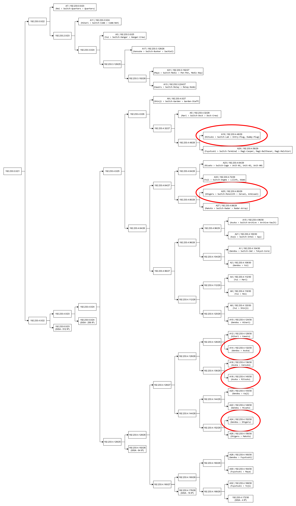

# Pohon IP

## 1. Tabel Koneksi Kotak untuk Digambar di draw.io

Setiap kotak di pohon biner VLSM selalu bercabang dua: cabang **Bit `0` (Atas/Kiri)** dan cabang **Bit `1` (Bawah/Kanan)** hingga berhenti di **Daun** (33 subnet aktif + 5 blok sisa).

| Prefix | Dari Kotak (Parent) | Cabang Bit | Ke Kotak (Child) | Keterangan |
| --- | --- | --- | --- | --- |
| `/21 → /22` | `192.233.0.0/21` | `0` (Atas) | `192.233.0.0/22` | Cabang |
| `/21 → /22` | `192.233.0.0/21` | `1` (Bawah) | `192.233.4.0/22` | Cabang |
| `/22 → /23` | `192.233.0.0/22` | `0` (Atas) | **`A7 | 192.233.0.0/23`** (`Rei > Switch-Quarters > Quarters`) | Daun LAN |
| `/22 → /23` | `192.233.0.0/22` | `1` (Bawah) | `192.233.2.0/23` | Cabang |
| `/23 → /24` | `192.233.2.0/23` | `0` (Atas) | **`A11 | 192.233.2.0/24`** (`Hikari > Switch-Comm > Comm-Net`) | Daun LAN |
| `/23 → /24` | `192.233.2.0/23` | `1` (Bawah) | `192.233.3.0/24` | Cabang |
| `/24 → /25` | `192.233.3.0/24` | `0` (Atas) | **`A3 | 192.233.3.0/25`** (`Yui > Switch-Hangar > Hangar-Crew`) | Daun LAN |
| `/24 → /25` | `192.233.3.0/24` | `1` (Bawah) | `192.233.3.128/25` | Cabang |
| `/25 → /26` | `192.233.3.128/25` | `0` (Atas) | **`A17 | 192.233.3.128/26`** (`Kensuke > Switch-Bunker > Sachiel`) | Daun LAN |
| `/25 → /26` | `192.233.3.128/25` | `1` (Bawah) | `192.233.3.192/26` | Cabang |
| `/26 → /27` | `192.233.3.192/26` | `0` (Atas) | **`A31 | 192.233.3.192/27`** (`Maya > Switch-Medic > Pen-Pen, Medic-Bay`) | Daun LAN |
| `/26 → /27` | `192.233.3.192/26` | `1` (Bawah) | **`A13 | 192.233.3.224/27`** (`Kaworu > Switch-Relay > Relay-Node`) | Daun LAN |
| `/22 → /23` | `192.233.4.0/22` | `0` (Atas) | `192.233.4.0/23` | Cabang |
| `/22 → /23` | `192.233.4.0/22` | `1` (Bawah) | `192.233.6.0/23` *(SISA - 512 IP)* | Daun Sisa |
| `/23 → /24` | `192.233.4.0/23` | `0` (Atas) | `192.233.4.0/24` | Cabang |
| `/23 → /24` | `192.233.4.0/23` | `1` (Bawah) | `192.233.5.0/24` *(SISA - 256 IP)* | Daun Sisa |
| `/24 → /25` | `192.233.4.0/24` | `0` (Atas) | `192.233.4.0/25` | Cabang |
| `/24 → /25` | `192.233.4.0/24` | `1` (Bawah) | `192.233.4.128/25` | Cabang |
| `/25 → /26` | `192.233.4.0/25` | `0` (Atas) | `192.233.4.0/26` | Cabang |
| `/25 → /26` | `192.233.4.0/25` | `1` (Bawah) | `192.233.4.64/26` | Cabang |
| `/26 → /27` | `192.233.4.0/26` | `0` (Atas) | **`A9 | 192.233.4.0/27`** (`Shinji > Switch-Garden > Garden-Staff`) | Daun LAN |
| `/26 → /27` | `192.233.4.0/26` | `1` (Bawah) | `192.233.4.32/27` | Cabang |
| `/27 → /28` | `192.233.4.32/27` | `0` (Atas) | **`A5 | 192.233.4.32/28`** (`Mari > Switch-Dock > Dock-Crew`) | Daun LAN |
| `/27 → /28` | `192.233.4.32/27` | `1` (Bawah) | `192.233.4.48/28` | Cabang |
| `/28 → /29` | `192.233.4.48/28` | `0` (Atas) | **`A19 | 192.233.4.48/29`** (`Ritsuko > Switch-Lab > Entry-Plug, Dummy-Plug`) | **Daun LAN (Lingkari #1)** |
| `/28 → /29` | `192.233.4.48/28` | `1` (Bawah) | **`A29 | 192.233.4.56/29`** (`Fuyutsuki > Switch-Terminal > Magi-Casper, Magi-Balthasar, Magi-Melchior`) | Daun LAN |
| `/26 → /27` | `192.233.4.64/26` | `0` (Atas) | `192.233.4.64/27` | Cabang |
| `/26 → /27` | `192.233.4.64/26` | `1` (Bawah) | `192.233.4.96/27` | Cabang |
| `/27 → /28` | `192.233.4.64/27` | `0` (Atas) | `192.233.4.64/28` | Cabang |
| `/27 → /28` | `192.233.4.64/27` | `1` (Bawah) | `192.233.4.80/28` | Cabang |
| `/28 → /29` | `192.233.4.64/28` | `0` (Atas) | **`A23 | 192.233.4.64/29`** (`Misato > Switch-Cage > Unit-01, Unit-02, Unit-00`) | Daun LAN |
| `/28 → /29` | `192.233.4.64/28` | `1` (Bawah) | **`A33 | 192.233.4.72/29`** (`Toji > Switch-Dogma > Lilith, Adam`) | Daun LAN |
| `/28 → /29` | `192.233.4.80/28` | `0` (Atas) | **`A25 | 192.233.4.80/29`** (`Shigeru > Switch-Monolith > Zeruel, Armisael`) | **Daun LAN (Lingkari #5)** |
| `/28 → /29` | `192.233.4.80/28` | `1` (Bawah) | **`A27 | 192.233.4.88/29`** (`Makoto > Switch-Radar > Radar-Array`) | Daun LAN |
| `/27 → /28` | `192.233.4.96/27` | `0` (Atas) | `192.233.4.96/28` | Cabang |
| `/27 → /28` | `192.233.4.96/27` | `1` (Bawah) | `192.233.4.112/28` | Cabang |
| `/28 → /29` | `192.233.4.96/28` | `0` (Atas) | `192.233.4.96/29` | Cabang |
| `/28 → /29` | `192.233.4.96/28` | `1` (Bawah) | `192.233.4.104/29` | Cabang |
| `/29 → /30` | `192.233.4.96/29` | `0` (Atas) | **`A15 | 192.233.4.96/30`** (`Asuka > Switch-Archive > Archive-Vault`) | Daun LAN |
| `/29 → /30` | `192.233.4.96/29` | `1` (Bawah) | **`A21 | 192.233.4.100/30`** (`Kaji > Switch-Intel > Spy`) | Daun LAN |
| `/29 → /30` | `192.233.4.104/29` | `0` (Atas) | **`A1 | 192.233.4.104/30`** (`Gendou > Switch-Cmd > Tokyo3-Core`) | Daun LAN |
| `/29 → /30` | `192.233.4.104/29` | `1` (Bawah) | **`A2 | 192.233.4.108/30`** (`Gendou > Yui`) | Daun Link |
| `/28 → /29` | `192.233.4.112/28` | `0` (Atas) | `192.233.4.112/29` | Cabang |
| `/28 → /29` | `192.233.4.112/28` | `1` (Bawah) | `192.233.4.120/29` | Cabang |
| `/29 → /30` | `192.233.4.112/29` | `0` (Atas) | **`A4 | 192.233.4.112/30`** (`Yui > Mari`) | Daun Link |
| `/29 → /30` | `192.233.4.112/29` | `1` (Bawah) | **`A6 | 192.233.4.116/30`** (`Yui > Rei`) | Daun Link |
| `/29 → /30` | `192.233.4.120/29` | `0` (Atas) | **`A8 | 192.233.4.120/30`** (`Yui > Shinji`) | Daun Link |
| `/29 → /30` | `192.233.4.120/29` | `1` (Bawah) | **`A10 | 192.233.4.124/30`** (`Gendou > Hikari`) | Daun Link |
| `/25 → /26` | `192.233.4.128/25` | `0` (Atas) | `192.233.4.128/26` | Cabang |
| `/25 → /26` | `192.233.4.128/25` | `1` (Bawah) | `192.233.4.192/26` *(SISA - 64 IP)* | Daun Sisa |
| `/26 → /27` | `192.233.4.128/26` | `0` (Atas) | `192.233.4.128/27` | Cabang |
| `/26 → /27` | `192.233.4.128/26` | `1` (Bawah) | `192.233.4.160/27` | Cabang |
| `/27 → /28` | `192.233.4.128/27` | `0` (Atas) | `192.233.4.128/28` | Cabang |
| `/27 → /28` | `192.233.4.128/27` | `1` (Bawah) | `192.233.4.144/28` | Cabang |
| `/28 → /29` | `192.233.4.128/28` | `0` (Atas) | `192.233.4.128/29` | Cabang |
| `/28 → /29` | `192.233.4.128/28` | `1` (Bawah) | `192.233.4.136/29` | Cabang |
| `/29 → /30` | `192.233.4.128/29` | `0` (Atas) | **`A12 | 192.233.4.128/30`** (`Hikari > Kaworu`) | Daun Link |
| `/29 → /30` | `192.233.4.128/29` | `1` (Bawah) | **`A14 | 192.233.4.132/30`** (`Gendou > Asuka`) | **Daun Link (Lingkari #3)** |
| `/29 → /30` | `192.233.4.136/29` | `0` (Atas) | **`A16 | 192.233.4.136/30`** (`Asuka > Kensuke`) | Daun Link |
| `/29 → /30` | `192.233.4.136/29` | `1` (Bawah) | **`A18 | 192.233.4.140/30`** (`Asuka > Ritsuko`) | **Daun Link (Lingkari #2)** |
| `/28 → /29` | `192.233.4.144/28` | `0` (Atas) | `192.233.4.144/29` | Cabang |
| `/28 → /29` | `192.233.4.144/28` | `1` (Bawah) | `192.233.4.152/29` | Cabang |
| `/29 → /30` | `192.233.4.144/29` | `0` (Atas) | **`A20 | 192.233.4.144/30`** (`Gendou > Kaji`) | Daun Link |
| `/29 → /30` | `192.233.4.144/29` | `1` (Bawah) | **`A22 | 192.233.4.148/30`** (`Gendou > Misato`) | Daun Link |
| `/29 → /30` | `192.233.4.152/29` | `0` (Atas) | **`A24 | 192.233.4.152/30`** (`Gendou > Shigeru`) | **Daun Link (Lingkari #4)** |
| `/29 → /30` | `192.233.4.152/29` | `1` (Bawah) | **`A26 | 192.233.4.156/30`** (`Shigeru > Makoto`) | Daun Link |
| `/27 → /28` | `192.233.4.160/27` | `0` (Atas) | `192.233.4.160/28` | Cabang |
| `/27 → /28` | `192.233.4.160/27` | `1` (Bawah) | `192.233.4.176/28` *(SISA - 16 IP)* | Daun Sisa |
| `/28 → /29` | `192.233.4.160/28` | `0` (Atas) | `192.233.4.160/29` | Cabang |
| `/28 → /29` | `192.233.4.160/28` | `1` (Bawah) | `192.233.4.168/29` | Cabang |
| `/29 → /30` | `192.233.4.160/29` | `0` (Atas) | **`A28 | 192.233.4.160/30`** (`Gendou > Fuyutsuki`) | Daun Link |
| `/29 → /30` | `192.233.4.160/29` | `1` (Bawah) | **`A30 | 192.233.4.164/30`** (`Fuyutsuki > Maya`) | Daun Link |
| `/29 → /30` | `192.233.4.168/29` | `0` (Atas) | **`A32 | 192.233.4.168/30`** (`Fuyutsuki > Toji`) | Daun Link |
| `/29 → /30` | `192.233.4.168/29` | `1` (Bawah) | `192.233.4.172/30` *(SISA - 4 IP)* | Daun Sisa |

---

## 2. Daftar 5 Kotak yang Dilingkari

1. **`A19 | 192.233.4.48/29`** (`Ritsuko > Switch-Lab > Entry-Plug, Dummy-Plug`) — subnet asal `Dummy-Plug`
2. **`A18 | 192.233.4.140/30`** (`Asuka > Ritsuko`) — link dari router `Ritsuko` ke `Asuka`
3. **`A14 | 192.233.4.132/30`** (`Gendou > Asuka`) — link dari router `Asuka` ke `Gendou`
4. **`A24 | 192.233.4.152/30`** (`Gendou > Shigeru`) — link dari router `Gendou` ke `Shigeru`
5. **`A25 | 192.233.4.80/29`** (`Shigeru > Switch-Monolith > Zeruel, Armisael`) — subnet tujuan `Armisael`

---

## 3. Hasil

